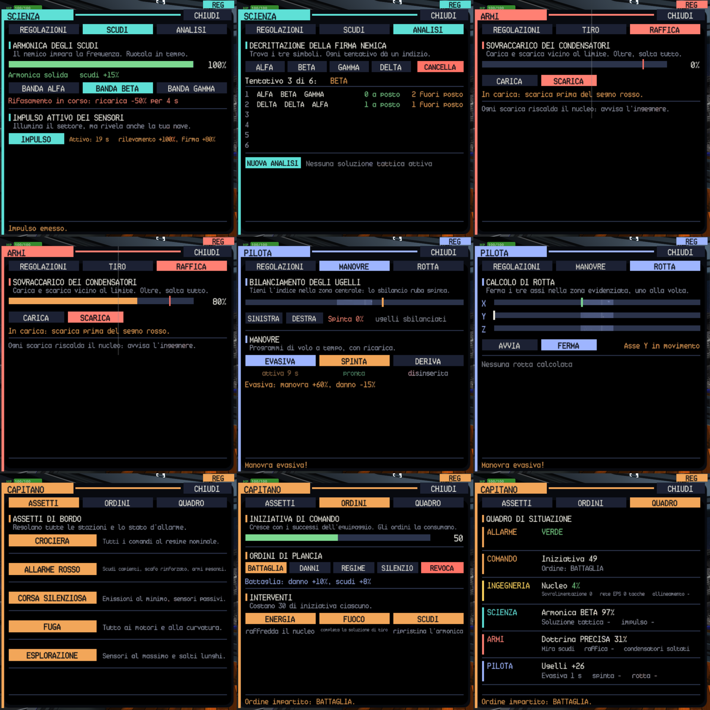
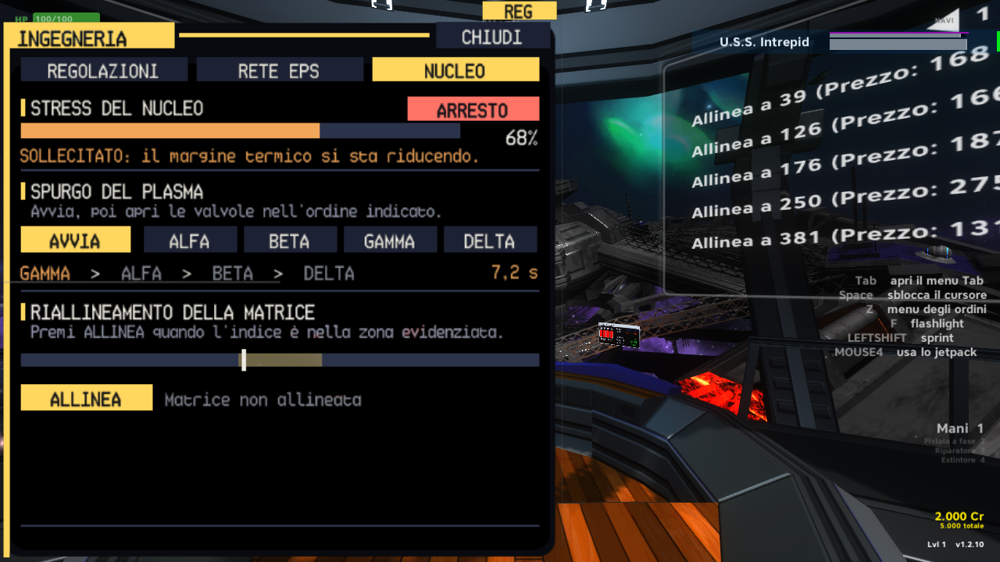
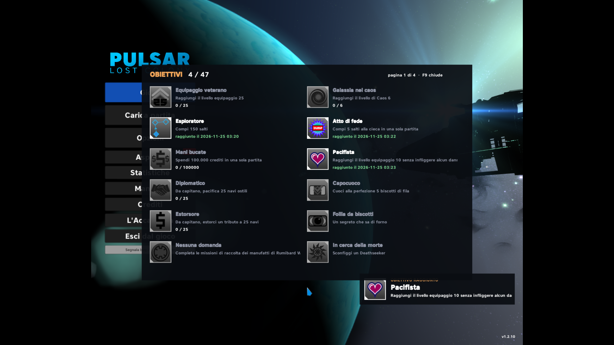
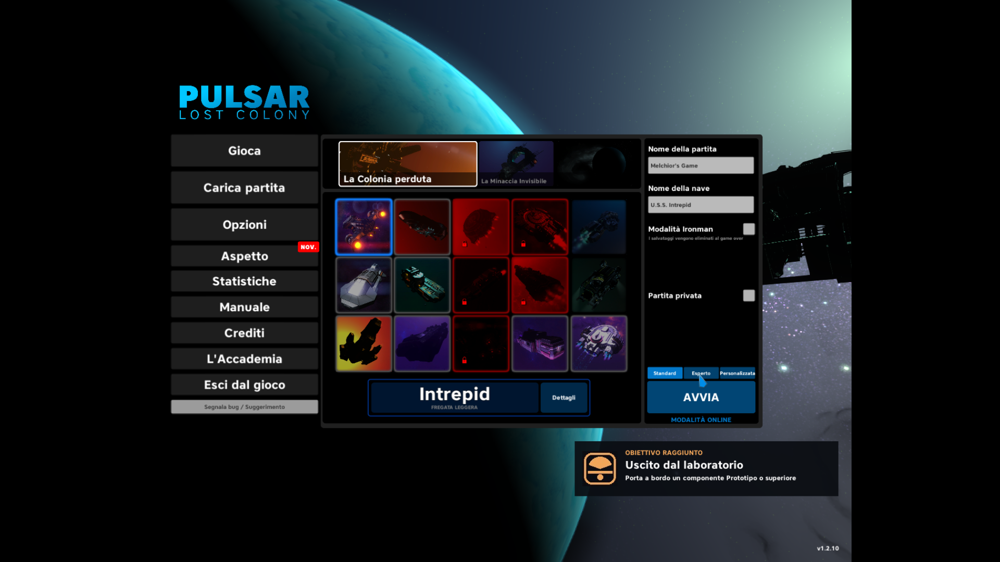
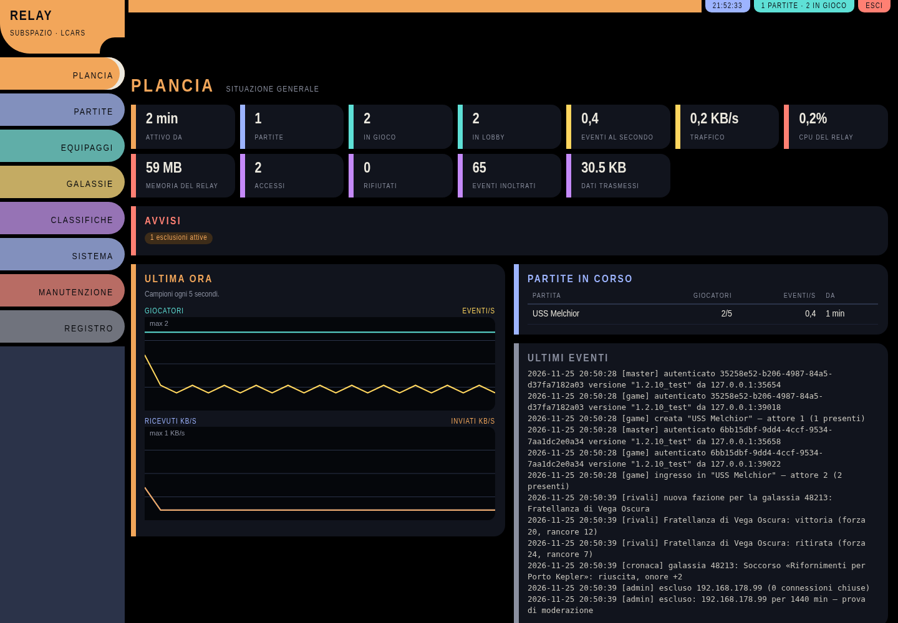
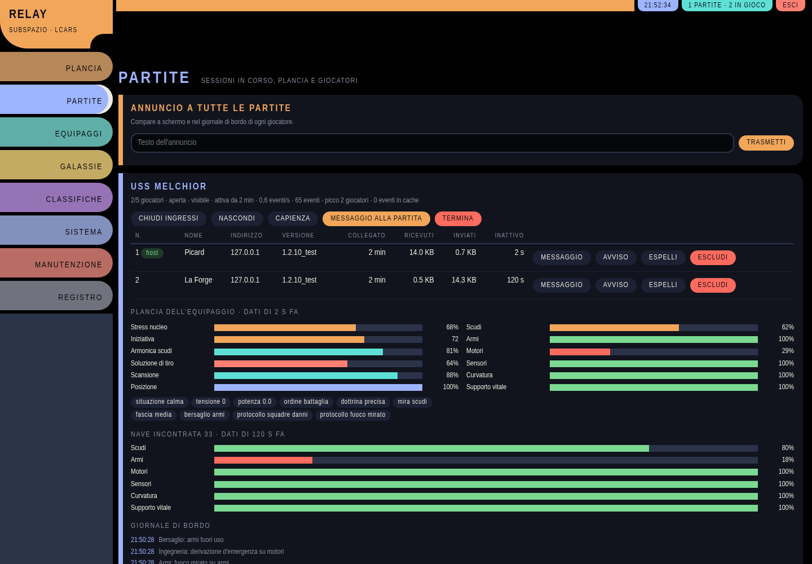
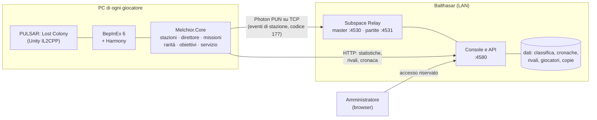

# PULSAR: Lost Colony — Enhanced (mod Melchior)


Un mod che trasforma **PULSAR: Lost Colony** in un'esperienza più profonda, viva e in omaggio alla fantascienza televisiva: postazioni di plancia in stile **LCARS** con vere procedure da eseguire, un **direttore** che dà ritmo alla partita, **missioni procedurali** e **archi narrativi** con conseguenze che durano, **fazioni rivali** che crescono anche mentre non giocate, un sistema di **rarità del bottino**, **obiettivi** e **stato di servizio**. Il tutto **completamente in italiano** e **senza Steam**, con un server cooperativo proprio per la rete di casa: il **Subspace Relay**.



---

## Indice

- [In breve](#in-breve)
- [Le stazioni di plancia](#le-stazioni-di-plancia)
- [Il direttore e la galassia viva](#il-direttore-e-la-galassia-viva)
- [Missioni procedurali](#missioni-procedurali)
- [Archi narrativi e conseguenze](#archi-narrativi-e-conseguenze)
- [Bottino, obiettivi e carriera](#bottino-obiettivi-e-carriera)
- [Italiano e niente Steam](#italiano-e-niente-steam)
- [Subspace Relay: il server di casa](#subspace-relay-il-server-di-casa)
- [Console di amministrazione](#console-di-amministrazione)
- [Architettura](#architettura)
- [Installazione](#installazione)
- [Configurazione](#configurazione)
- [Sviluppo e collaudo](#sviluppo-e-collaudo)
- [Reverse engineering](#reverse-engineering)
- [Struttura del repository](#struttura-del-repository)
- [Stato e limiti noti](#stato-e-limiti-noti)
- [Crediti e avvertenze](#crediti-e-avvertenze)

---

## In breve

| Area | Cosa aggiunge |
|---|---|
| **Stazioni** | 21 schede LCARS sui pannelli fisici della nave, una o più per ogni ruolo, con regolazioni continue, procedure a tempo e scelte tattiche che si influenzano a vicenda |
| **Ufficiali automatici** | I bot dell'equipaggio usano davvero i pannelli: spurghi, scansioni, mira, fasce d'ingaggio, ordini |
| **Direttore** | Misura la tensione a bordo e alterna calma, allerta, crisi e respiro; sceglie eventi in proporzione alla potenza dell'equipaggio |
| **Missioni** | 570 missioni nel sistema nativo del gioco: 9 famiglie × 5 livelli × 6 varianti, più 3 archi narrativi |
| **Galassia viva** | Fazioni rivali persistenti per ogni galassia, onore e infamia, conseguenze ritardate, cronaca salvata sul server |
| **Bottino** | 8 gradi di rarità, livelli nascosti e 23 affissi per i componenti della nave |
| **Carriera** | 47 obiettivi interni (con le icone originali), 14 gradi, 5 specializzazioni, classifica di rete |
| **Lingua** | Traduzione italiana completa: 10.690 stringhe, glossario e controlli automatici |
| **Rete** | Server compatibile con Photon per la LAN, con console di amministrazione LCARS riservata |

---

## Le stazioni di plancia

Ogni ruolo ha la sua postazione **fisica** a bordo: le regolazioni non stanno in un menu, si usano andando al pannello e premendo **REG**. Le pagine riprendono lo stile LCARS — gomiti colorati, barre piatte, un colore per stazione — e sono costruite su una griglia comune perché restino ordinate e leggibili anche quando sono dense di informazioni. Solo l'ufficiale di quella stazione (o il capitano) può modificarle; lo stato viaggia in rete fra tutti i giocatori.

| Stazione | Schede | In sintesi |
|---|---|---|
| **Capitano** | Assetti · Ordini · Quadro · Protocolli · Giornale | Assetti di bordo con stato d'allarme, iniziativa di comando alimentata dai successi dell'equipaggio, ordini di plancia (battaglia, danni, regime, silenzio), interventi d'emergenza, protocolli permanenti, quadro di situazione e giornale di bordo condiviso |
| **Pilota** | Regolazioni · Manovre · Rotta · Ingaggio | Assetto dei propulsori, ugelli che si sbilanciano e vanno tenuti in asse, manovra evasiva (riduce i danni subiti), spinta d'emergenza, deriva silenziosa, calcolo di rotta su tre assi, fascia di distanza d'ingaggio da tenere |
| **Scienza** | Regolazioni · Scudi · Analisi · Sensori | Armonica degli scudi che il nemico impara col tempo, impulso attivo dei sensori, decrittazione della firma nemica (soluzione tattica alle armi), scansione del bersaglio con dati, sistemi e punto debole |
| **Armi** | Regolazioni · Tiro · Raffica · Bersaglio | Dottrina di tiro che matura, puntamento su scudi o scafo, sovraccarico dei condensatori (scaricare prima del segno rosso), fuoco mirato sui sottosistemi nemici |
| **Ingegneria** | Regolazioni · Rete EPS · Nucleo · Danni | Rete EPS a bilancio zero su sei canali, stress del nucleo con spurgo del plasma e riallineamento della matrice, arresto di sicurezza, controllo danni con due squadre, derivazione d'emergenza |

I sistemi sono intrecciati: la Scienza scansiona e rende possibile il fuoco mirato delle Armi; ogni raffica scalda il nucleo dell'Ingegneria; i colpi allo scafo guastano scudi, armi, motori, sensori, curvatura e supporto vitale, che rendono meno finché le squadre non li riparano; il capitano spende l'iniziativa guadagnata dagli altri.


<table>
<tr>
<td></td>
<td></td>
<td></td>
</tr>
<tr><td align="center">Rete EPS a bilancio</td><td align="center">Nucleo: spurgo e allineamento</td><td align="center">Regolazioni continue</td></tr>
</table>

**Ufficiali automatici.** Quando una stazione è affidata a un bot, l'host ne simula le decisioni sugli stessi sistemi: gestione del nucleo e della rete EPS, rotazione dell'armonica e decrittazioni, dottrina, mira con isteresi e raffiche, ugelli e manovre, ordini del capitano solo con un nemico davvero ingaggiato. Hanno un margine d'errore regolabile: fanno il loro lavoro, ma un giocatore attento fa meglio.

---

## Il direttore e la galassia viva

Il **direttore** gira sull'host e ogni due secondi valuta la **tensione** a bordo: nemici vicini e la loro forza rispetto alla nostra, danni recenti, scafo e sistemi malridotti. Alterna quattro fasi — **calma, allerta, crisi, respiro** — e, quando la calma dura abbastanza, sceglie un evento adatto:

- **combattimento** (solo nello spazio aperto): imboscata, sciame di droni, cacciatore di taglie, squadra della fazione rivale;
- **anomalie di bordo**: tempesta ionica, picco di plasma, interferenza subspaziale, microfratture — colpiscono proprio i sistemi gestiti dalle stazioni;
- **missione procedurale** o inizio di un **arco narrativo**.

La difficoltà segue la **potenza dell'equipaggio**, calcolata da livello, persone a bordo (giocatori e bot) e rarità media dell'equipaggiamento: cambiano i tipi di nave, il loro numero e i modificatori (da *trascurata* e *vulnerabile* fino a *corazzata*, *brutale*, *d'élite*). Gli eventi recenti diventano meno probabili, per non ripetersi.

**Fazioni rivali.** Ogni galassia ha una forza ostile generata dal server, con nome, capo e carattere (per esempio *Flotta del Sole Spento*, guidata dal *Comandante Kor*). Cresce col **tempo reale** anche quando nessuno gioca, si indebolisce quando la sconfiggete e si rafforza se fuggite. Con il rancore alto arriva il capo in persona; se cade, un successore prende il comando e giura vendetta. Al rientro in partita l'equipaggio riceve i **rapporti d'intelligence** arrivati nel frattempo.

---

## Missioni procedurali

Le missioni sono costruite **dentro il sistema nativo del gioco** (le *pickup mission*): settore dedicato sulla mappa stellare, navi con nome, obiettivi e ricompense, interfaccia e sincronizzazione sono quelle originali. Il catalogo è generato in modo deterministico su ogni macchina, quindi host e client hanno gli stessi dati senza doverli scambiare.

| Famiglia | Cosa succede | Stazioni coinvolte |
|---|---|---|
| **Caccia** | Una taglia su una nave con nome; ai livelli alti anche un limite di salti | Armi, Pilota |
| **Soccorso** | Predoni attorno a una nave civile; reputazione presso l'Unione Coloniale | Armi |
| **Ricognizione** | Raggiungere un'anomalia e analizzarla con l'impulso dei sensori | Scienza |
| **Scorta** | Proteggere un convoglio mentre carica la curvatura, con ondate di predoni | Tutte |
| **Primo contatto** | Avvicinare una specie sconosciuta: scansione completa, poi ordine di silenzio; se si spara, fallisce | Scienza, Capitano |
| **Recupero** | Scansionare un relitto e recuperarne la scatola nera, poi respingere gli sciacalli; in premio un componente | Scienza, Armi |
| **Anomalia temporale** | Da una fenditura esce una copia ostile della vostra stessa nave | Tutte |
| **Evacuazione** | Tenere in piedi il supporto vitale sotto una tempesta di radiazioni | Ingegneria |
| **Interdizione** | Tre ondate di incursori entro un limite di salti | Armi, Pilota |

Ogni famiglia ha 5 livelli di difficoltà e 6 varianti, con nomi, luoghi e personaggi propri: **270 missioni**, più le **300 parti** degli archi narrativi.

---

## Archi narrativi e conseguenze

Gli **archi** sono storie in tre parti con gli stessi personaggi, in cui l'esito di una parte decide la successiva:

- **Il silenzio** — un segnale antico, il primo contatto; se va bene si scorta l'ambasciata, se va male arriva la rappresaglia.
- **La taglia** — il luogotenente di un fuorilegge, il relitto con la rotta per il covo, l'ammiraglia del capo.
- **La caduta** — una colonia chiede aiuto, va evacuata, i profughi vanno scortati in un porto sicuro.

**Onore e infamia** cambiano con gli esiti e spostano gli eventi del direttore: con più infamia arrivano più cacciatori di taglie e rivali, con più onore più richieste di missione. Qualche salto dopo una missione arrivano le **conseguenze ritardate**: la gratitudine di chi avete salvato (crediti), la vendetta degli amici di chi avete abbattuto, la rappresaglia dopo un contatto fallito, una scatola nera che apre un nuovo arco, un paradosso temporale. Tutto è salvato sul server, galassia per galassia, e prosegue fra una sessione e l'altra.

---

## Bottino, obiettivi e carriera

**Rarità.** Ogni componente della nave ha un grado fra otto — da *Standard* a *Singolare* — che porta livelli nascosti in più e fino a quattro **affissi** scelti fra 23 per tipo di componente. Il grado è salvato nell'identificativo del componente, quindi sopravvive a salvataggi, negozi e rete.


**Obiettivi.** 47 obiettivi interni: i 41 originali con le loro icone e il testo in italiano, più quelli legati alle aggiunte del mod. Si consultano con **F9**.



**Stato di servizio.** Statistiche personali (tempo per ruolo, salti, combattimenti, procedure di stazione, missioni…), 14 gradi da *Recluta* ad *Ammiraglio di flotta*, 5 specializzazioni con i loro titoli e la classifica di rete. Si consulta con **F10**.


---

## Italiano e niente Steam

Il gioco è **interamente in italiano**: 10.690 stringhe tradotte con glossario coerente (gradi, sistemi, termini di plancia) e controlli automatici su segnaposto e formattazione. Tutti i riferimenti a Steam sono stati tolti dall'interfaccia e il multigiocatore passa dal Subspace Relay invece che dal cloud di Photon.



---

## Subspace Relay: il server di casa

Un server Node.js, senza dipendenze esterne, che parla il protocollo di **Photon PUN** (GpBinary 1.6 su TCP, scambio di chiavi Diffie-Hellman e cifratura AES): master server con lobby ed elenco partite, game server con stanze, proprietà, cache degli eventi e passaggio dell'host. In più:

- **classifica** e **statistiche globali** inviate dai giocatori, con copia di sicurezza giornaliera;
- **fazioni rivali** e **cronache delle galassie** persistenti;
- **telemetria di plancia** letta dagli eventi delle stazioni, **giornale di bordo** e **storico delle partite**;
- **annunci** a schermo, messaggi privati, avvisi, espulsioni ed **esclusioni** (anche a tempo e per indirizzo);
- **modalità manutenzione**, regolazioni dal vivo, riavvio pulito che salva tutto su disco.

Gira come servizio utente systemd su **Balthasar**, la macchina della rete di casa.

---

## Console di amministrazione

All'indirizzo `http://balthasar.local:4580/` c'è la console di gestione del server, nello stesso stile LCARS delle postazioni di bordo. È **riservata**: utente e password (salvata solo come hash scrypt), sessione in cookie protetto, blocco progressivo dopo i tentativi falliti, registro di ogni azione dell'amministratore.



| Sezione | Contenuto |
|---|---|
| **Plancia** | Uptime, partite, giocatori, eventi al secondo, traffico, CPU, memoria, avvisi, grafici dell'ultima ora |
| **Partite** | Ingressi aperti o chiusi, visibilità, capienza, messaggi, chiusura; per ogni giocatore traffico, inattività, messaggio privato, avviso, espulsione, esclusione; plancia della nave in diretta e giornale di bordo |
| **Equipaggi** | Registro di tutti i giocatori visti dal server (nomi, indirizzi, versione, accessi, avvisi, note) con ricerca ed esclusioni |
| **Galassie** | Cronache (onore, infamia, archi, conseguenze in attesa) e fazioni rivali |
| **Classifiche** | Classifica per qualsiasi voce, statistiche globali con i primati, partite concluse, profili di servizio |
| **Sistema** | Grafici di un'ora o di 24 ore (rete, eventi, giocatori, CPU, memoria, ritardo del ciclo di eventi), dati della macchina e del relay |
| **Manutenzione** | Regolazioni dal vivo, modalità manutenzione, copie di sicurezza ed esportazione, riavvio, cambio password, sessioni aperte |
| **Registro** | Registro del server filtrabile e azioni dell'amministratore |

<table>
<tr>
<td></td>
<td></td>
</tr>
<tr><td align="center">Partite: giocatori e plancia in diretta</td><td align="center">Sistema: telemetria</td></tr>
<tr>
<td></td>
<td></td>
</tr>
<tr><td align="center">Galassie: cronache e rivali</td><td align="center">Accesso riservato</td></tr>
</table>

---

## Architettura



- Il plugin **non registra tipi propri** nel dominio IL2CPP: sotto Wine l'iniezione di classi corrompe la memoria. Si aggancia invece a metodi del gioco con Harmony (`PhotonHandler.Update` per il ciclo, `PLNetworkManager.OnGUI` per l'interfaccia a schermo) e a deviazioni native (detour) dove Harmony non può agire, come i costruttori.
- Le pagine delle stazioni sono costruite con l'API degli schermi del gioco (`PLUIScreen`), quindi vivono **sui monitor 3D della nave**.
- Lo stato delle stazioni è per nave e viaggia con un evento Photon proprio; l'host simula le chiavi dinamiche (nucleo, scansioni, manovre, danni, direttore) e le ripete periodicamente, così chi entra dopo si allinea da solo.
- Le missioni si registrano nelle due liste della campagna (`MissionTypes` e `PickupMissionTypes`) su ogni macchina; gli obiettivi personalizzati si completano sull'host.

---

## Installazione

### Giocare su Windows

1. Sul PC di sviluppo: `mod/pacchetto.sh dist "NomeGiocatore" --zip` crea `dist/PULSAR-Melchior-NomeGiocatore.zip` (circa 3,3 GB).
2. Sul PC Windows: estrai lo zip, per esempio in `C:\Giochi` (non in «Programmi»), e avvia `PULSAR_LostColony.exe`. Il mod si carica da solo tramite `winhttp.dll`.
3. Le istruzioni complete sono nel `LEGGIMI.txt` del pacchetto; il nome del giocatore si cambia in `settings.xml` (`<PlayerName>`).

### Giocare su Linux (Wine)

- Dal pacchetto: `./gioca.sh` (prepara un prefisso Wine proprio la prima volta); `MELCHIOR_WINDOW=1280x720 ./gioca.sh` per giocare in finestra.
- Dal repository di sviluppo: `mod/play.sh`.
- In `BepInEx/config/BepInEx.cfg` deve restare `UnityLogListening = false`.

### Il server su Balthasar

```bash
rsync -a server/ balthasar.local:subspace-relay-src/
ssh balthasar.local 'bash ~/subspace-relay-src/deploy/installa.sh'
ssh balthasar.local 'cd ~/subspace-relay && echo "password" | node server.js config.json --set-password admin'
```

`installa.sh` copia il relay in `~/subspace-relay`, crea la configurazione e lo avvia come servizio utente (`systemctl --user status subspace-relay`), attivo anche senza sessione aperta. Porte: **4530** e **4531** TCP per il gioco, **4580** per la console.

### Puntare il gioco al server

In `BepInEx/config/melchior.core.cfg`, sezione `[Relay]`: `Host = balthasar.local` e `Fallback = 192.168.178.27` (usato se il nome non si risolve). Con `Host = 127.0.0.1`, `mod/play.sh` avvia un relay locale.

---

## Configurazione

Tutti i file si trovano in `BepInEx/config/` e vengono creati con i valori predefiniti al primo avvio.

| File | Contenuto |
|---|---|
| `melchior.core.cfg` | Relay (host, riserva, porta), strumenti di sviluppo e diagnostica |
| `melchior.stations.json` | Comandi delle stazioni e loro effetti, assetti, bilanci, nucleo, scienza, armi, pilota, capitano, danni, sensori, ingaggio, protocolli, ufficiali automatici |
| `melchior.director.json` | Tempi di calma, allerta e respiro, soglie di tensione, pesi degli eventi, navi per fascia di potenza |
| `melchior.rarity.json` | Gradi di rarità, probabilità, livelli bonus, affissi |
| `melchior.ranking.json` | Statistiche, gradi e specializzazioni dello stato di servizio |
| `melchior.ui.json` | Lingua e pulizia dell'interfaccia |
| `server/config.json` | Porte, indirizzi, credenziali (hash), messaggio di benvenuto, limiti, manutenzione, conservazione dei dati |

---

## Sviluppo e collaudo

```bash
mod/Melchior.Core/build.sh          # compila il plugin (csc dell'SDK .NET, senza NuGet) e lo copia nel gioco
mod/tools/sig.sh Assembly-CSharp 'PLShipStats' 'Hull'   # firme interop di tipi e membri del gioco
node server/test/smoke.js           # collaudo end-to-end del relay: protocollo, partite, amministrazione, accesso
```

**Prove in gioco senza mouse né tastiera.** Con `DevConsole = true` il plugin esegue i comandi scritti in `BepInEx/config/melchior.cmd`; gli script in `mod/tools/prova/` li usano per avviare una partita in finestra, entrare a bordo, aprire i pannelli, scattare schermate e provare missioni e archi:

```bash
mod/tools/prova/newgame.sh 0                    # nuova partita come capitano
mod/tools/prova/cmd.sh "panels" "shot prova"    # elenca i pannelli e scatta una schermata
mod/tools/prova/famiglie.sh scorta              # avvia una missione, salta nel settore e la porta a termine
```

Alcuni comandi della console: `ships`, `spawn`, `target`, `hit`, `panels click`, `con get|set`, `dir` (direttore), `mis` (missioni, anche `mis warp`), `saga` (cronaca), `rival`, `journal`, `svc`, `ach`. Con `MELCHIOR_INSTANCE=2` si avvia una seconda istanza sullo stesso computer per le prove a due giocatori.

---

## Reverse engineering

Il gioco è compilato con IL2CPP: il codice C# originale non c'è. Il lavoro è partito da qui:

- `re/tools/il2cpp_meta.py` e `il2cpp_addrs.py` leggono i metadati IL2CPP e risolvono l'indirizzo di ogni metodo;
- gli script Ghidra in `re/tools/ghidra_scripts/` etichettano le funzioni e decompilano quelle che interessano;
- `lay.py`, `usage.py`, `xref.py` e `vt.py` ricavano il layout dei campi, i riferimenti a stringhe e tipi, i chiamanti e le tabelle virtuali;
- la campagna originale (186 missioni, 971 attori di dialogo) è un XML dentro gli asset, da cui sono stati ricavati i formati di obiettivi, ricompense e requisiti.

Il progetto Ghidra e le uscite (`re/out`) non sono nel repository: si rigenerano con questi strumenti a partire dal gioco.

---

## Struttura del repository

| Percorso | Contenuto |
|---|---|
| `mod/Melchior.Core/` | Il plugin: `Stations.cs` (stazioni e pannelli LCARS), `Director.cs`, `Missions.cs`, `Saga.cs`, `Rivals.cs`, `Bots.cs`, `Rarity.cs`, `Achievements.cs`, `Service.cs`, `Ui.cs`, `DevConsole.cs`, `Plugin.cs` |
| `mod/i18n/` | Traduzione italiana: blocchi di testo, glossario, correzioni, script di controllo e generazione |
| `mod/achievements/` | Definizioni e icone degli obiettivi |
| `mod/tools/` | Lettore delle firme interop e script di prova in gioco |
| `mod/pacchetto.sh`, `mod/play.sh` | Pacchetto per altri PC e avvio sotto Wine |
| `server/` | Subspace Relay: `server.js`, `lib/` (protocollo, partite, accesso, telemetria, rivali), `admin.html`, `test/`, `deploy/` |
| `re/tools/` | Strumenti di reverse engineering |
| `docs/` | Schermate |

---

## Stato e limiti noti

Verificato in gioco, con salti veri e due istanze in rete: tutte le stazioni e le loro procedure, gli ufficiali automatici, il direttore, le fazioni rivali, tutte e 9 le famiglie di missione, un arco narrativo completo e le conseguenze ritardate, la sincronizzazione fra due client attraverso Balthasar, la console di amministrazione.

Ancora da verificare o da fare:

- una partita giocata a mano, con persone vere alle stazioni, e su due computer diversi;
- l'avvio su Windows del pacchetto (provato finora sotto Wine);
- salvataggio e caricamento con una missione in corso; chi entra a partita già iniziata;
- alcuni testi ancora in inglese (per esempio *Press [F8] to skip warp*);
- HTTPS per la console di amministrazione (oggi è HTTP sulla rete di casa).

---

## Crediti e avvertenze

**PULSAR: Lost Colony** è di **Leafy Games**. Questo è un progetto amatoriale, non affiliato né approvato dagli autori del gioco, pensato per l'uso personale su una copia legittima del gioco. Il repository non contiene il gioco; testi originali (nella traduzione), icone degli obiettivi e schermate appartengono ai rispettivi proprietari.

Strumenti usati: [BepInEx](https://github.com/BepInEx/BepInEx), [Harmony](https://github.com/pardeike/Harmony), [Il2CppInterop](https://github.com/BepInEx/Il2CppInterop), [Ghidra](https://ghidra-sre.org/), Node.js. Il mod e il server sono stati sviluppati con l'assistenza di Claude.
