# PULSAR: Lost Colony — Enhanced (mod Melchior)


Un mod che trasforma **PULSAR: Lost Colony** in un'esperienza più profonda, viva e in omaggio alla fantascienza televisiva: postazioni di plancia in stile **LCARS** con vere procedure da eseguire, un **direttore** che dà ritmo alla partita, **missioni procedurali** e **archi narrativi** con conseguenze che durano, una galassia con **guerre, crisi, reputazione e personaggi ricorrenti** che si ricordano di voi, **fazioni rivali** che crescono anche mentre non giocate, un sistema di **rarità del bottino**, **obiettivi** e **stato di servizio**. Il tutto **completamente in italiano** e **senza Steam**, con un server cooperativo proprio per la rete di casa: il **Subspace Relay**.


---

## Indice

- [In breve](#in-breve)
- [Le stazioni di plancia](#le-stazioni-di-plancia)
- [Abbordaggi](#abbordaggi)
- [Ricerca scientifica](#ricerca-scientifica)
- [L'equipaggio: una squadra vera](#lequipaggio-una-squadra-vera)
- [Voci](#voci)
- [Usura e manutenzione](#usura-e-manutenzione)
- [Fabbricazione a bordo](#fabbricazione-a-bordo)
- [Passeggeri](#passeggeri)
- [Talenti, gradi e capitani NPC](#talenti-gradi-e-capitani-npc)
- [Borsa delle merci](#borsa-delle-merci)
- [Traffico locale](#traffico-locale)
- [L'IA dei nemici](#lia-dei-nemici)
- [Il direttore e la galassia viva](#il-direttore-e-la-galassia-viva)
- [Una galassia che vive da sola](#una-galassia-che-vive-da-sola)
  - [Indagini e archeologia](#indagini-e-archeologia)
- [Missioni procedurali](#missioni-procedurali)
- [Archi narrativi e conseguenze](#archi-narrativi-e-conseguenze)
- [Bottino, obiettivi e carriera](#bottino-obiettivi-e-carriera)
- [Italiano e niente Steam](#italiano-e-niente-steam)
- [Subspace Relay: il server di casa](#subspace-relay-il-server-di-casa)
- [Console di amministrazione](#console-di-amministrazione)
- [Architettura](#architettura)
- [Installazione](#installazione)
- [Configurazione](#configurazione)
- [Sviluppo e collaudo](#sviluppo-e-collaudo)
- [Modelli 3D importati](#modelli-3d-importati)
- [Reverse engineering](#reverse-engineering)
- [Struttura del repository](#struttura-del-repository)
- [Stato e limiti noti](#stato-e-limiti-noti)
- [Licenza](#licenza)
- [Crediti e avvertenze](#crediti-e-avvertenze)

---

## In breve

| Area | Cosa aggiunge |
|---|---|
| **Stazioni** | 30 schede LCARS sui pannelli fisici della nave, una o più per ogni ruolo, con regolazioni continue, procedure a tempo e scelte tattiche che si influenzano a vicenda |
| **Ufficiali automatici** | I bot dell'equipaggio usano davvero i pannelli: spurghi, scansioni, mira, fasce d'ingaggio, ordini |
| **Un equipaggio vero** | I bot valutano la gravità della situazione, si dividono i compiti come una squadra (chi spegne, chi respinge, chi rianima, chi resta al timone), imparano dall'esperienza, salgono di livello e scelgono da soli i propri talenti |
| **Comando dell'equipaggio** | Dottrina di squadra, postura e specialità di ogni ufficiale, regole d'ingaggio per ritirata e abbordaggi, rapporto dello stato: dalla scheda Equipaggio del capitano |
| **Relitti alla deriva** | Dopo le battaglie restano scafi da esplorare (ingegneria, scansione o assalto rapido): componenti, merci, registri, sopravvissuti e trappole |
| **Indagini e archeologia** | Segnali misteriosi da localizzare e decifrare, rovine di civiltà scomparse da scavare con metodo o in fretta, spedizioni rivali, reliquie da studiare, donare o vendere (e qualche maledizione) |
| **Passeggeri** | Coloni, profughi, pellegrini, tecnici, medici, ricercati e clandestini con un umore di viaggio, eventi a bordo e figure che camminano davvero sui ponti |
| **Usura e manutenzione** | Sette sistemi che si consumano con l'uso, rendono meno e si guastano; manutenzione con i ricambi, revisione in cantiere; anche le navi NPC hanno il loro stato |
| **Fabbricazione a bordo** | Un'officina che trasforma le merci della stiva in carburante, refrigerante, ricambi, razioni, farmaci, vino, sonde e componenti, con una coda di lavorazioni |
| **Voci** | Comparse, vagabondi e passeggeri parlano quando ci si avvicina, in fumetti sopra la testa, e a volte discutono fra loro |
| **HUD rivestito** | Elenco navi, tasti, oggetti in mano e crediti nello stile a pillole del riquadro in alto a sinistra, tutto allineato e leggibile |
| **Abbordaggi** | Squadre che si teletrasportano quando gli scudi del bersaglio cedono: incursioni nemiche da respingere, nostri assalti che sabotano e saccheggiano, navi catturate; anche i predoni abbordano i mercanti |
| **Ricerca scientifica** | Dati raccolti esplorando, studiando specie e fenomeni, lanciando sonde e coi laboratori, spesi in nove tecnologie permanenti |
| **Talenti e capitani NPC** | Venti talenti di postazione guadagnati con gradi e specializzazioni; ufficiali bot e capitani NPC hanno livello, esperienza e talenti con le stesse regole dei giocatori |
| **Logistica di bordo** | Viveri consumati a ogni salto, medicinali che accorciano le ferite e salvano dalle epidemie, paghe degli ufficiali: razionamento, fame, arretrati e congedi per protesta |
| **Porti vivi** | Ogni porto ha prosperità, sicurezza ed eventi (carenze, scioperi, feste, blocchi dei pirati, boom, epidemie) che cambiano prezzi, traffico e reclute, e che si risolvono con quello che facciamo |
| **Borsa delle merci** | Nove merci con prezzi diversi in ogni porto secondo fazioni, crisi, guerre, stagioni e nostre basi; mercati che reagiscono a ciò che compriamo e vendiamo; contrabbando, ispezioni e predoni attirati dalla stiva piena |
| **Traffico locale** | Ogni settore in cui ci si ferma si popola di navi con un mestiere (mercanti, minatori, corrieri, recuperatori, pellegrini, ricercatori, pattuglie, cacciatori di taglie, profughi) che arrivano, ripartono, parlano sul canale locale, si assaltano, si soccorrono e rispondono alle nostre chiamate |
| **IA nemica** | Navi con ruoli (assaltatore, fiancheggiatore, cecchino) che attaccano da angoli diversi, cercano la poppa, ripiegano per ricaricare gli scudi e tornano, chiamano rinforzi; mira con intercettazione vera; equipaggi a piedi che pensano più in fretta, mirano meglio, concentrano il fuoco e ripiegano verso i compagni |
| **Direttore** | Misura la tensione a bordo e alterna calma, allerta, crisi e respiro; sceglie eventi in proporzione alla potenza dell'equipaggio |
| **Missioni** | 570 missioni nel sistema nativo del gioco: 9 famiglie × 5 livelli × 6 varianti, più 3 archi narrativi |
| **Galassia viva** | Guerra fra fazioni sulla mappa stellare, flotte con un'agenda (convogli, pattuglie, predoni), bacheca dei contratti, notiziario del subspazio, tempo che passa anche senza giocatori, fazioni rivali persistenti, onore e infamia, conseguenze ritardate |
| **Reputazione** | Da guerra aperta a leggenda presso ogni fazione: prezzi dei negozi, pattuglie che vi intercettano, rifugi e rifornimenti, compensi; legata alla reputazione nativa del gioco e salvata |
| **Personaggi ricorrenti** | Pirati, trafficanti e comandanti ribelli con soprannome, grado e tratti, che ricordano ogni incontro, tornano sfregiati dalle capsule di salvataggio e lasciano eredi in cerca di vendetta; taglie con rotta tracciata |
| **Incontri con scelta** | 31 situazioni, 3 incontri di porto e 7 tipi di luoghi da esplorare, da risolvere dal pannello del capitano: opzioni sbloccate dalle stazioni, esiti probabili, seguiti che tornano qualche salto dopo |
| **Esplorazione** | Luoghi nascosti in un settore su quattro, Atlante delle scoperte, frammenti di mappa e luoghi leggendari con guardiano |
| **Ambienti stellari** | Nebulose, asteroidi, radiazioni, tempeste di plasma, pozzi gravitazionali, correnti subspaziali e quiete: un settore su tre ha condizioni proprie, attenuate dalle stazioni giuste |
| **Meraviglie e cataclismi** | Eventi rari: una supernova da cui evacuare una colonia, una cometa errante da inseguire, allineamenti subspaziali, ondate di spazio morto |
| **Annali della flotta** | Le imprese maggiori di ogni equipaggio restano su Balthasar e diventano leggenda nelle galassie future: dicerie, relitti, voci nella banca dati |
| **Nomi dei settori** | Ogni settore ha un nome proprio (quello del gioco o uno generato), usato in tutti i testi insieme al numero |
| **Sonde di ricognizione** | La Scienza lancia sonde che esaminano i settori vicini; dal rapporto si traccia la rotta |
| **Ricercati** | L'infamia e le fazioni ostili mettono una taglia sulla vostra testa: cacciatori sempre più numerosi, conti da saldare in porto |
| **Sfida della settimana** | Balthasar propone ogni settimana la stessa sfida a tutti gli equipaggi della rete di casa, con premio e classifica |
| **Covi dei pirati** | I personaggi di grado alto fondano covi che si fortificano col tempo; assaltarli su contratto vale un grosso bottino |
| **Basi e atti di fondazione** | Atti di fondazione da comprare al catasto dei porti o da guadagnare: miniere, empori, laboratori, cantieri, fortezze e fari da fondare nei settori liberi, far crescere, rifornire e difendere |
| **Porto di casa** | Un porto da adottare: riposo e riparazioni gratuite al ritorno, una prosperità che cresce con voi, assalti da respingere |
| **Specie aliene** | Quattro specie da incontrare con un primo contatto, da capire con la Scienza e con cui firmare un accordo, ognuno con un vantaggio unico |
| **Banca dati** | Enciclopedia di bordo che si riempie giocando: fazioni, personaggi, luoghi, reliquie, fenomeni, equipaggi, minacce |
| **Vita di bordo** | Liti, compleanni, clandestini, replicatori guasti, febbri misteriose, nostalgia di casa, tornei e promozioni contese, con i nomi veri degli ufficiali |
| **Chiamate al bersaglio** | Il capitano chiama la nave agganciata: notizie e piste dalle navi amiche, la resa da quelle nemiche malridotte; i personaggi ricorrenti si catturano |
| **Cantiere navale** | Sette migliorie permanenti della nave in tre livelli, acquistabili in porto dalla scheda Cantiere dell'Ingegneria |
| **Campagne delle fazioni** | Quattro campagne in tre atti (battaglia, dilemma, ammiraglio nemico) offerte dalle fazioni alleate, con un'onorificenza che rende l'alleanza permanente |
| **Storie a puntate e trofei** | Tre storie in più parti con bivi (la nave fantasma, il finanziatore, l'erede) e una sala dei trofei per ogni impresa importante |
| **Vocazione e stagioni** | L'equipaggio diventa ciò che fa (esploratori, mercanti, cacciatori di taglie, diplomatici, corsari, guardiani), con vantaggi crescenti; stagioni galattiche che cambiano le regole per qualche salto |
| **La grande minaccia** | Un arco lungo per ogni galassia: una minaccia con un nome cresce in quattro fasi fino a rivelare il suo cuore; fermarla è l'impresa più grande, ignorarla porta la catastrofe |
| **Diario e ambizioni** | Data stellare, diario del capitano scritto dai fatti della partita, «Nella puntata precedente…» al rientro, tre ambizioni a lungo termine con premi importanti |
| **Equipaggi concorrenti** | Tre liberi equipaggi che prendono i contratti lasciati sulla bacheca, riscuotono taglie, arrivano prima ai luoghi leggendari e si contendono con voi una classifica di fama |
| **Diplomazia** | Rapporti fra le fazioni (guerra, tensione, pace, alleanza) che evolvono da soli, decidono chi si combatte sulla mappa e si possono cambiare con le ambasciate |
| **Commercio e porti** | Trasporti di merci e contrabbando con rotta tracciata, dogane e predoni che puntano al carico; taverna, cantiere e mercato nero all'attracco |
| **Equipaggio** | Ufficiali con nome, grado, tratto e carriera alle stazioni dei bot; feriti, caduti e congedi; morale che cambia con scelte, vittorie e licenze a terra; fama nei porti citata da chi vi incontra |
| **Crisi galattiche** | Epidemia, guerra aperta, corsa all'anomalia, blocco delle rotte: eventi in tre fasi che cambiano la galassia e si risolvono (o no) con l'equipaggio |
| **Bottino** | 8 gradi di rarità, 86 affissi (statistici, di stazione, condizionali, legati a commercio, abbordaggi, ricerca, viveri, dogane, fama, morale, difetti), 32 leggendari con nome e storia, 4 set, 12 case produttrici con stile e prestigio, modello, numero di serie e qualità per ogni esemplare, Officina per smontare e potenziare |
| **Carriera** | 121 obiettivi interni (con le icone originali e 80 nuovi del mod), 14 gradi, 5 specializzazioni, 20 talenti, classifica di rete |
| **Lingua** | Traduzione italiana completa: 10.690 stringhe, glossario e controlli automatici |
| **Rete** | Server compatibile con Photon per la LAN, con console di amministrazione LCARS riservata |

---

## Le stazioni di plancia

Ogni ruolo ha la sua postazione **fisica** a bordo: le regolazioni non stanno in un menu, si usano andando al pannello e premendo **REG**. Le pagine sono un terminale LCARS futuristico disegnato interamente dalla mod: caratteri da terminale (un atlante bitmap cotto da JetBrains Mono, incluso con la sua licenza), gomito LCARS e barra laterale a segmenti, pulsanti e schede a pillola con riflesso e cornice luminosa, barre di livello a segmenti, griglia tecnica e righe di scansione sullo sfondo, una spia che pulsa nell'intestazione e una linea di scansione che scorre sullo schermo. Ogni stazione ha la sua coppia di colori (ambra e lilla per il capitano, azzurro e verde acqua per il pilota, turchese e viola per la scienza, rosso e arancio per le armi, giallo e arancio per l'ingegneria). Le texture sono generate al volo, senza file grafici, e tutto è costruito su una griglia comune perché resti ordinato e leggibile anche quando è denso di informazioni.

<table>
<tr>
<td>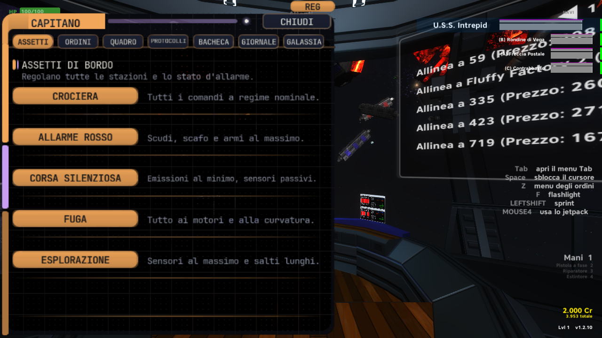</td>
<td>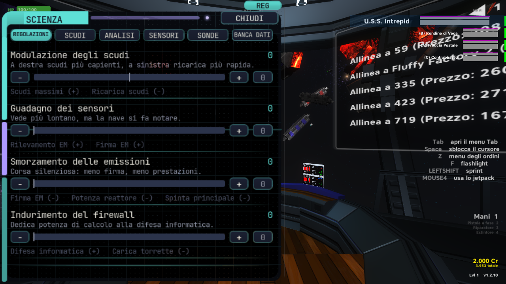</td>
</tr>
<tr><td align="center">Capitano: assetti di bordo</td><td align="center">Scienza: regolazioni continue</td></tr>
<tr>
<td>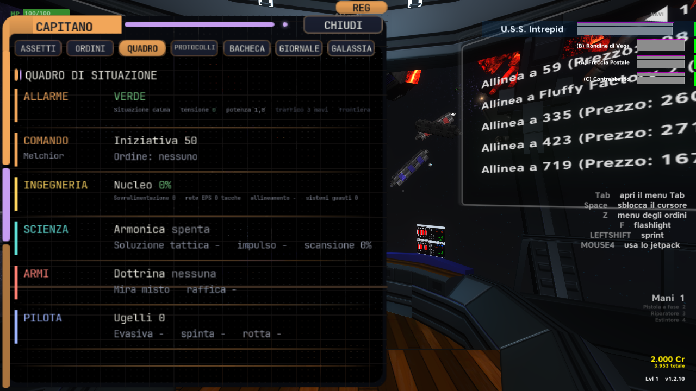</td>
<td>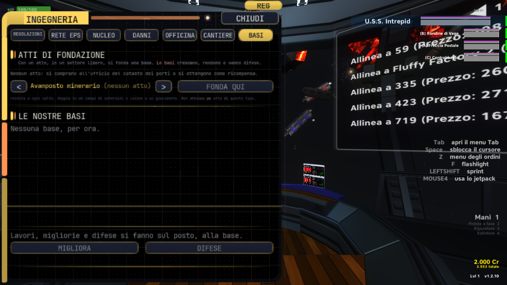</td>
</tr>
<tr><td align="center">Quadro di situazione</td><td align="center">Ingegneria: basi e atti di fondazione</td></tr>
</table> Solo l'ufficiale di quella stazione (o il capitano) può modificarle; lo stato viaggia in rete fra tutti i giocatori.

**L'HUD di gioco** segue lo stesso linguaggio del riquadro in alto a sinistra (salute, ossigeno, equipaggio): pillole piene dagli angoli arrotondati con il valore scritto dentro, etichette nel colore della pillola e un contorno scuro che le rende leggibili su qualsiasi sfondo, tutto in una colonna ordinata con lo stesso margine. L'elenco **NAVI** colora ogni nome secondo il rapporto (nostra, ostile, civile, alleata), mostra lo scafo in una pillola con il suo valore (solo per le navi già scansionate, come vuole il gioco) e gli scudi in una pillola sottile sopra; i **promemoria dei tasti** hanno i tasti in pillole tutte uguali, nomi leggibili («Maiusc», «Spazio», «Mouse 4») e descrizioni tradotte; gli **oggetti in mano** sono pillole numerate, quella attiva in ambra; i **crediti** stanno in una pillola dorata con il totale sotto. Si disattiva da configurazione (`[Interfaccia] HudRivestito`) o in console (`hud off`).

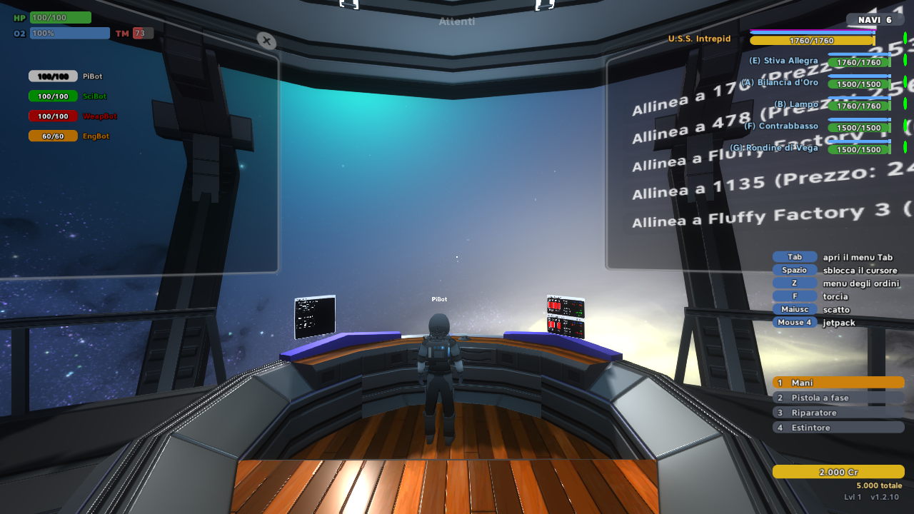

| Stazione | Schede | In sintesi |
|---|---|---|
| **Capitano** | Assetti · Ordini · Quadro · Protocolli · Bacheca · Giornale · Galassia | Assetti di bordo con stato d'allarme, iniziativa di comando alimentata dai successi dell'equipaggio, ordini di plancia (battaglia, danni, regime, silenzio), interventi d'emergenza, protocolli permanenti, quadro di situazione, giornale di bordo condiviso, bacheca dei contratti e quadro della galassia (reputazione, crisi, ricercati) |
| **Pilota** | Regolazioni · Manovre · Rotta · Ingaggio | Assetto dei propulsori, ugelli che si sbilanciano e vanno tenuti in asse, manovra evasiva (riduce i danni subiti), spinta d'emergenza, deriva silenziosa, calcolo di rotta su tre assi, fascia di distanza d'ingaggio da tenere |
| **Scienza** | Regolazioni · Scudi · Analisi · Sensori · Sonde · Banca dati | Armonica degli scudi che il nemico impara col tempo, impulso attivo dei sensori, decrittazione della firma nemica (soluzione tattica alle armi), scansione del bersaglio con dati, sistemi e punto debole |
| **Armi** | Regolazioni · Tiro · Raffica · Bersaglio | Dottrina di tiro che matura, puntamento su scudi o scafo, sovraccarico dei condensatori (scaricare prima del segno rosso), fuoco mirato sui sottosistemi nemici |
| **Ingegneria** | Regolazioni · Rete EPS · Nucleo · Danni · Officina · Cantiere | Rete EPS a bilancio zero su sei canali, stress del nucleo con spurgo del plasma e riallineamento della matrice, arresto di sicurezza, controllo danni con due squadre, derivazione d'emergenza, officina per smontare e potenziare i pezzi della stiva |

I sistemi sono intrecciati: la Scienza scansiona e rende possibile il fuoco mirato delle Armi; ogni raffica scalda il nucleo dell'Ingegneria; i colpi allo scafo guastano scudi, armi, motori, sensori, curvatura e supporto vitale, che rendono meno finché le squadre non li riparano; il capitano spende l'iniziativa guadagnata dagli altri.

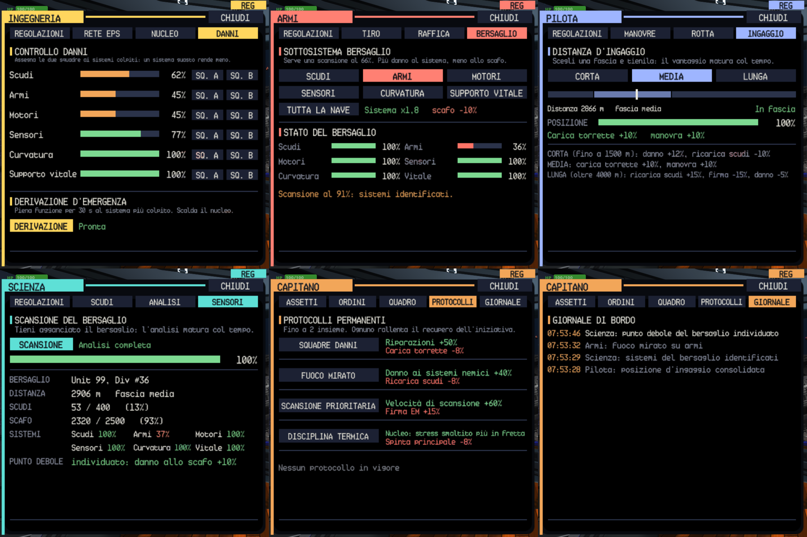

<table>
<tr>
<td>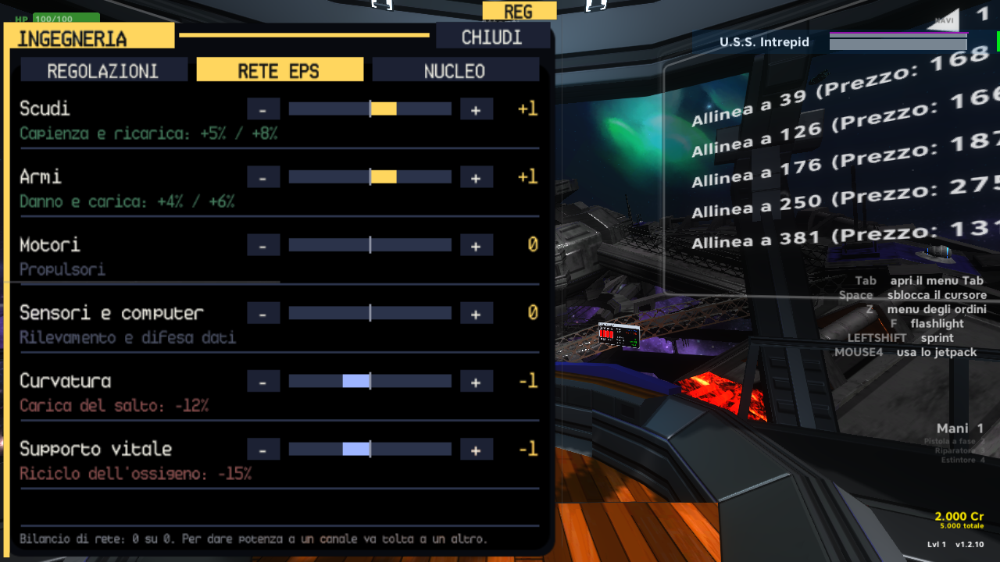</td>
<td></td>
<td>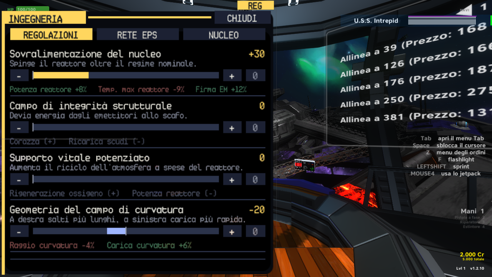</td>
</tr>
<tr><td align="center">Rete EPS a bilancio</td><td align="center">Nucleo: spurgo e allineamento</td><td align="center">Regolazioni continue</td></tr>
</table>

**Ufficiali automatici.** Quando una stazione è affidata a un bot, l'host ne simula le decisioni sugli stessi sistemi: gestione del nucleo e della rete EPS, rotazione dell'armonica e decrittazioni, dottrina, mira con isteresi e raffiche, ugelli e manovre, ordini del capitano solo con un nemico davvero ingaggiato. Hanno un margine d'errore regolabile: fanno il loro lavoro, ma un giocatore attento fa meglio.

---

## Abbordaggi

Il teletrasporto funziona solo se la nave d'arrivo ha interni (i droni no), ha gli scudi a terra (8% o meno), è entro 4 km (di più con il talento Inseguitore) e nessuna delle due è in curvatura. Le regole sono le stesse per tutti.

- **Incursioni nemiche.** Quando i nostri scudi cedono, le navi nemiche con equipaggio possono mandarci una squadra. Gli incursori compaiono al teletrasporto e sabotano i sistemi finché restano a bordo; il nostro equipaggio li affronta nei corridoi. Respinti, lasciano a volte le loro armi o un prigioniero da interrogare (sa dov'è il covo della sua banda, o fa un nome che vale una taglia), da consegnare o da liberare. Se resistono per un minuto e mezzo, saccheggiano cassa e stiva e ripartono.
- **I nostri assalti.** Dalla scheda Ordini del capitano: **ABBORDAGGIO** manda la squadra sulla nave agganciata (con l'ordine nativo d'abbordaggio dei bot), **RIENTRO** la richiama. Il pannello dice se l'abbordaggio è possibile e perché no. A bordo la squadra sabota i sistemi nemici e svuota le casse; gli equipaggi nemici rinascono, quindi la nave si prende abbattendone tanti quanti ne aveva. Una nave catturata si può smontare e vendere a pezzi, svuotarne la stiva, perquisire in cerca di prigionieri da liberare o consegnare alla fazione del settore. Abbordare chi non ci attaccava è pirateria; gli ufficiali feriti nell'assalto finiscono in infermeria, e se la nave esplode con la squadra a bordo tornano tutti feriti.
- **Il traffico.** I predoni che assaltano un mercante, appena gli scudi della vittima cedono, la abbordano; se nessuno li ferma la nave è perduta.

## Ricerca scientifica

I dati di ricerca arrivano dai luoghi esplorati, dai luoghi leggendari, dalle sonde, dallo studio delle specie aliene, dagli eventi rari, dai laboratori delle nostre basi e dalle analisi di routine quando la Scienza è presidiata (il doppio durante la fiera dell'Accademia). Dalla scheda **Ricerca** della Scienza si avvia un progetto alla volta, che costa dati e richiede qualche salto di lavoro: analisi dei mercati (i prezzi dei porti vicini arrivano da soli), idroponica di bordo (meno viveri), cartografia profonda (più frammenti di mappa), schermatura della firma (meno imboscate e cacciatori), medicina d'emergenza (più medicinali, ferite più brevi), automazione di bordo (paghe più basse), disturbatori di puntamento (i nemici mirano peggio), protocolli di resa e teoria della minaccia (la grande minaccia cresce più piano).

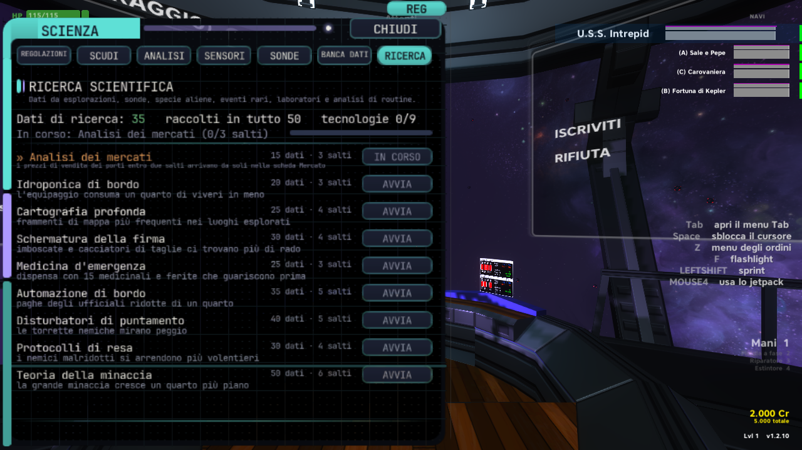

## L'equipaggio: una squadra vera

Giocando da soli, o con pochi amici e il resto dei posti affidato ai bot, l'equipaggio deve comportarsi come compagni umani. Nel gioco originale ogni bot sceglie per conto suo il compito in cima alla propria lista di priorità: finiscono tutti sullo stesso incendio, il pilota lascia il timone in piena battaglia per una scintilla, un ferito grave va a caccia di intrusi. Melchior aggiunge, sull'host, una **mente dell'equipaggio** che ragiona per la squadra.

- **Gravità.** Due volte al secondo valuta la situazione a bordo (incendi, intrusi, compagni a terra o feriti, sistemi e scafo danneggiati, battaglia in corso, reattore in fusione) e ne ricava una gravità: *calma*, *attenzione*, *pericolo*, *crisi*, *disperata*.
- **Chi fa cosa.** Per ogni emergenza decide quanti servono (un incendio ne richiede uno, sei incendi tre; contro gli intrusi uno in più di loro) e chi è più adatto, secondo ruolo, distanza, salute, competenza e carattere. Il compito sale in cima alla lista solo per chi è stato scelto; agli altri, quando l'emergenza è già coperta, non viene più chiesto di correre. Chi ha già un incarico tende a tenerlo, invece di cambiare idea a ogni respiro.
- **Ai posti di combattimento.** In battaglia il pilota resta al timone (lo lascia solo se la situazione è disperata) e l'ufficiale alle armi resta alla torretta, a meno di intrusi a bordo. La scienza cura i feriti, l'ingegneria spegne gli incendi e ripara.
- **Istinto di sopravvivenza.** Chi è ferito non va a cercare intrusi e si ritira a curarsi, a meno che la situazione sia disperata; un ferito grave lascia anche l'incarico che aveva.
- **Riflessi.** In emergenza i bot ripensano la situazione più spesso, e quelli con più esperienza ancora di più.
- **Voce.** Nei momenti che contano parlano nel giornale di bordo («Incendio! Ci penso io.», «Copritemi, lo rianimo!», «Intrusi neutralizzati.»), una voce per compito e senza ripetersi.

**Il comando dell'equipaggio.** Il capitano, soprattutto quando è solo con i bot, governa la squadra dalla scheda **Equipaggio** del suo pannello, a tre livelli, e la mente dell'equipaggio rispetta i suoi ordini:

- **dottrina di squadra**, con un tocco: *equilibrio* (ognuno valuta da sé, come sopra); *posti di combattimento* (tutti alle stazioni anche fuori dalla battaglia; incendi e riparazioni solo a scienza e ingegneria); *difesa interna* (contro gli intrusi tutti tranne il pilota); *controllo danni* (tutti tranne il pilota su incendi e riparazioni, anche dei danni leggeri); *scorta al capitano* (i due più adatti lo seguono ovunque, anche fuori nave); *riposo* (chi è ferito in infermeria, gli altri a riposo, niente lavori non urgenti). Un ufficiale conferma l'ordine a voce;
- **ordini individuali** per ogni stazione affidata a un bot: la **postura** (*a giudizio*, *al suo posto* qualunque cosa succeda, *scorta* personale del capitano, *riserva* che entra in gioco solo quando la situazione si fa seria, *libero* di seguire l'IA del gioco) e la **specializzazione** (antincendio, difesa, riparazioni, soccorso), che lo fa scegliere per quei compiti e orienta i talenti che sceglierà crescendo;
- **regole d'ingaggio**: sotto quale salute ci si ritira in infermeria (25, 40, 55 o 70%) e chi può andare all'abbordaggio (solo armi e comando, tutti tranne il pilota, nessuno).

Per ogni stazione la scheda mostra l'ufficiale, cosa sta facendo in quel momento, salute, lealtà, competenza migliore, carattere e ferite; il pulsante **RAPPORTO** fa parlare ogni ufficiale a turno, con le sue parole. Statistica «Ordini impartiti all'equipaggio», achievement *Al comando* e *Ogni situazione ha la sua dottrina*; la console di amministrazione mostra dottrina, posture e specializzazioni. Quando le schede di una stazione sono più di otto, la barra delle schede passa su due righe. In console di sviluppo: `ordine dottrina <nome>`, `ordine postura <classe>`, `ordine specialita <classe>`, `ordine ritirata`, `ordine abbordaggio`, `ordine rapporto`.

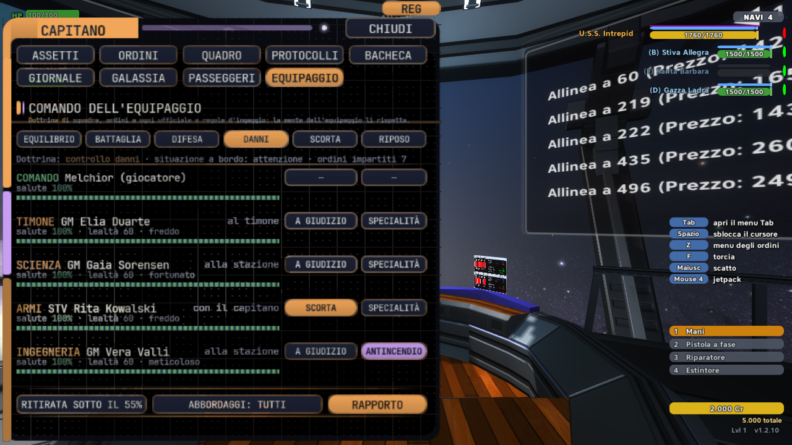

**Esperienza e crescita.** Gli interventi riusciti (un incendio domato, un intruso abbattuto, un compagno rianimato, un sistema riparato) fanno crescere le **competenze** personali di chi ci stava lavorando: antincendio, difesa, soccorso e riparazioni, ciascuna fino al livello 10, oltre all'esperienza e ai gradi degli ufficiali. Ogni livello di competenza vale un **punto talento** del gioco, che il bot spende da solo come farebbe una persona: parte dal proprio mestiere, ma pesano ciò che ha vissuto (chi ha spento molti incendi studia la prevenzione, chi è finito spesso a terra cerca corazza e resistenza, chi ha soccorso molti compagni affina il primo soccorso), ciò che manca alla squadra (se nessuno sa curare, la scienza ci pensa per prima) e il carattere (la testa calda punta sul fuoco, il veterano sulla corazza). Ogni scelta compare nel giornale di bordo con il suo perché, e due ufficiali dello stesso ruolo non crescono mai allo stesso modo. Le ferite si ricordano.

Statistiche del gruppo «Equipaggio» (interventi coordinati, incendi domati, intrusi respinti, compagni rianimati, competenze cresciute, talenti appresi) e achievement *Una squadra vera*, *Pompieri dello spazio*, *Nessuno sale a bordo*, *Non si lascia indietro nessuno*, *Maestro del mestiere*. Nella console di amministrazione la tabella degli ufficiali mostra le competenze. In console di sviluppo: `mente` (stato, incarichi e priorità di ogni bot), `mente on|off`.

## Voci

Le persone parlano. Le comparse e i vagabondi delle stazioni, e i passeggeri a bordo, quando il giocatore passa vicino dicono qualcosa; a volte due persone vicine si scambiano qualche battuta. Le frasi compaiono in un fumetto sopra la testa di chi parla, rivolto alla telecamera, e sfumano dopo qualche secondo. Non sono frasi a caso: vengono da ciò che succede davvero.

- **Il porto**: la festa, il blocco dei pirati, l'epidemia, lo sciopero dei portuali, il boom economico, la merce che manca, un porto che si spegne o che prospera.
- **La galassia**: il notiziario (il fronte, i convogli assaltati, le taglie, le dicerie, la scienza), la grande minaccia che si avvicina, i prezzi delle merci.
- **Noi**: se la nave è famosa la gente la riconosce («Posso stringervi la mano?»), cita le notizie che ci riguardano, ci ringrazia; se è famigerata si tiene a distanza; se c'è una taglia sopra, qualcuno se ne va.
- **I passeggeri**: parlano del viaggio secondo chi sono e come stanno (i profughi ringraziano, l'ospite illustre trova la cabina «rustica», il fuggiasco chiede di non averlo visto), si lamentano delle battaglie e dei ritardi.
- E la vita di tutti i giorni: il caffè sintetico che sa di ruggine, l'affitto delle cuccette, un gatto che si chiama Ammiraglio.

Tutto gira sul computer di ciascun giocatore, senza pesare sulla rete. Statistiche «Voci ascoltate» e «Volte in cui la gente parlava di noi», achievement *Sulla bocca di tutti*. In console di sviluppo: `voci`, `voci on|off`, `voci x` (fa parlare il più vicino), `voci su <classe>`.

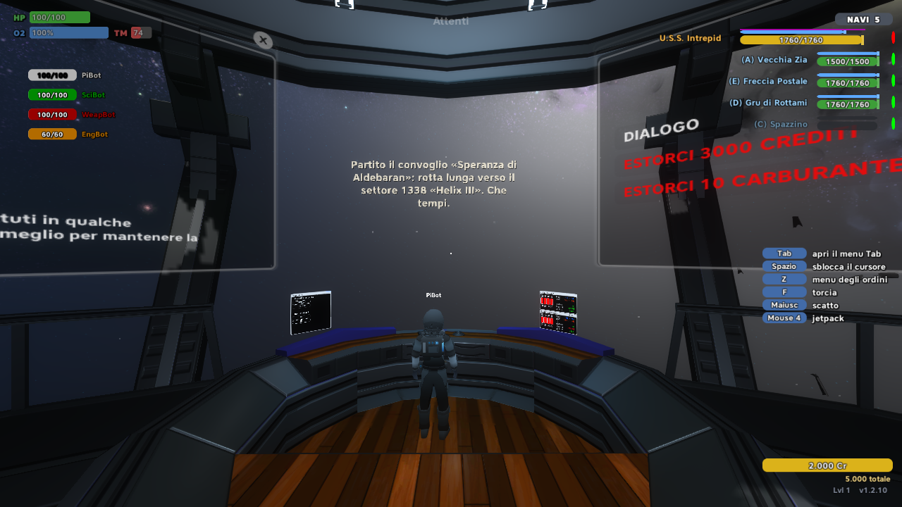

## Usura e manutenzione

La nave invecchia con l'uso. Sette sistemi hanno uno stato da 0 a 100%, e ciascuno si consuma con ciò che lo sollecita davvero:

- **nucleo**: a ogni salto, e di più con la sovralimentazione e in battaglia;
- **generatore degli scudi**: con i colpi assorbiti;
- **propulsori**: in battaglia e con le manovre evasive;
- **motore a curvatura**: a ogni salto, più di tutti;
- **torrette**: sparando;
- **sensori**: nelle nebulose e nelle tempeste;
- **supporto vitale**: con le persone a bordo, passeggeri compresi.

Sopra l'80% non si nota nulla; sotto, il sistema rende un po' meno (meno energia dal nucleo e più calore, scudi più deboli e più lenti a ricaricarsi, spinta, carica di curvatura, danni e raffreddamento delle torrette, portata dei sensori, ricambio d'aria), con una curva che scende piano fino al 30% e poi più in fretta. Sotto il 25% arrivano i **guasti spontanei**: scintille, relè che cedono, sistemi che si spengono e ripartono zoppicando. A zero il sistema è **in avaria** e rende la metà. I componenti di qualità (rarità alta) e un ingegnere esperto, o meticoloso, rallentano il consumo.

La **manutenzione** usa i **ricambi** della stiva (la merce della borsa: ognuno restituisce circa il 20%), si fa quando non si combatte e fa crescere l'ingegnere; la **revisione completa** si paga in un cantiere di porto e riporta tutto al 100%. L'ingegnere bot fa manutenzione da solo quando la nave è tranquilla (consumando ricambi), e i tecnici in viaggio come passeggeri danno una mano. Anche le **navi NPC** hanno il loro stato, coerente con il mestiere (i predoni sono malandati, le pattuglie tenute come gioielli, i relitti dei rottami), con gli stessi effetti sulle prestazioni; chiamandole, si capisce in che condizioni sono. Nuova scheda **Manutenzione** dell'Ingegneria; statistiche del gruppo «Manutenzione», achievement *Chiave inglese*, *Officina di bordo*, *Come nuova* e uno nascosto; la console di amministrazione mostra lo stato di ogni sistema. In console di sviluppo: `usura`, `usura <sistema>` (manutenzione), `usura revisione`, `usura <sistema|tutti> <valore>`.

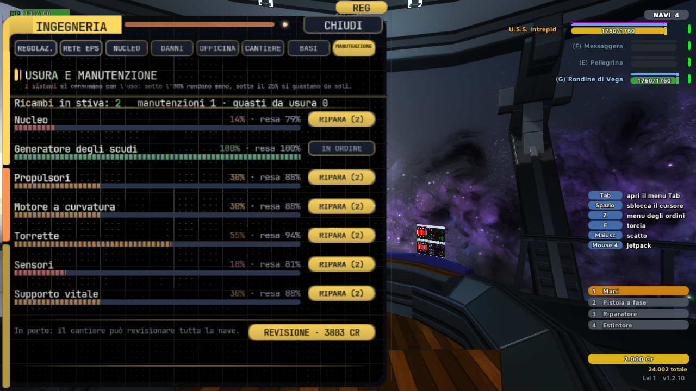

## Fabbricazione a bordo

L'officina di bordo trasforma le materie prime della stiva (le merci della borsa) in ciò che serve in viaggio, lontano dai porti:

| Lavorazione | Materie prime | Risultato | Tempo base |
|---|---|---|---|
| Capsula di carburante | 2 deuterio | una capsula per la curvatura | 2m 30s |
| Refrigerante del nucleo | 1 deuterio + 1 minerali | refrigerante +40% | 1m 30s |
| Ricambi | 2 minerali + 1 elettronica | 3 ricambi per la manutenzione | 2m |
| Razioni | 2 grano | 10 razioni nella dispensa | 1m |
| Farmaci | 1 grano + 1 elettronica | 4 dosi in infermeria (serve la ricerca *Medicina*) | 2m 30s |
| Vino di bordo | 3 grano | una cassa di vino da vendere | 6m |
| Sonda di ricognizione | 1 elettronica + 1 ricambi | il prossimo lancio di sonda è gratis | 2m |
| Componente della nave | 3 ricambi + 2 elettronica | un componente nuovo (serve la ricerca *Automazione*) | 5m |

Le materie prime si prelevano quando la lavorazione entra in coda (fino a quattro; annullando l'ultima tornano in stiva). L'officina lavora in tempo reale e **si ferma in battaglia**; da sola va a 0,6×, con un ingegnere umano alla stazione a 1,1×, con un ingegnere bot a 0,9× più un 5% per ogni livello di competenza nelle riparazioni, e i tecnici in viaggio come passeggeri aggiungono un 30%. La qualità dei componenti fabbricati cresce con l'esperienza dell'ingegnere. Ogni lavorazione fa crescere l'ingegnere e finisce nel giornale di bordo. Nuova scheda **Fabbrica** dell'Ingegneria; statistiche nel gruppo «Manutenzione», achievement *Banco di lavoro*, *Autosufficienza*, *Fatto in casa* e *Catena di montaggio*; la console di amministrazione mostra coda e totali. In console di sviluppo: `fabbrica`, `fabbrica <ricetta>`, `fabbrica annulla`, `fabbrica presto`.

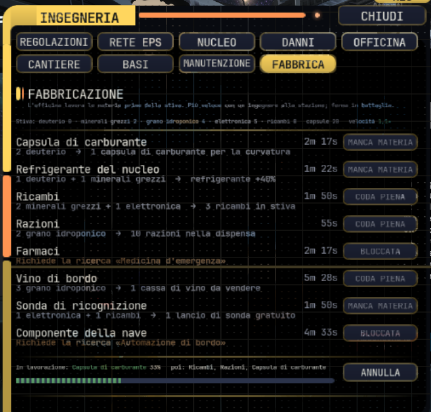

## Passeggeri

La nave non porta solo merci. Nei porti, all'attracco, c'è chi cerca un passaggio; nello spazio, le navi di profughi e di pellegrini chiamate dal capitano chiedono a volte di trasbordare qualcuno. I gruppi cambiano con le circostanze (più profughi quando la grande minaccia avanza o c'è una crisi, più medici durante un'epidemia, più pellegrini nei giorni di festa, più scienziati alla fiera dell'Accademia, coloni quando abbiamo basi da popolare, fuggiaschi se la nostra fama è più nera che bianca):

- **profughi** e **pellegrini**: pagano poco, ma portarli in salvo vale onore e morale;
- **scienziati dell'Accademia**: dati di ricerca e la sua fiducia; non amano le battaglie;
- **diplomatici**: reputazione presso la fazione del porto di destinazione; le battaglie li terrorizzano;
- **ospiti illustri**: pagano molto e portano fama, ma pretendono alloggi all'altezza;
- **coloni**: popolano le nostre basi (scorte, e ogni dieci coloni un livello);
- **tecnici** e **medici**: durante il viaggio danno una mano con le riparazioni e con gli ufficiali feriti;
- **fuggiaschi**: pagano in contanti e non fanno domande, ma qualcuno li sta cercando.

Occupano le cabine (sei, più tre per ogni livello degli **Alloggi migliori** del cantiere), mangiano i nostri viveri e hanno un **umore** che cambia a ogni salto: le battaglie, gli incendi, le falle nello scafo, la fame e i ritardi lo abbassano; un viaggio tranquillo, gli alloggi buoni e un equipaggio di buon umore lo alzano. All'arrivo pagano secondo l'umore (con una mancia se sono entusiasti) e lasciano il loro ricordo; se il viaggio va troppo male scendono alla prima occasione senza pagare, e la voce gira nei porti. A bordo succedono cose: un passeggero che si ammala, una lite in corridoio, un clandestino in stiva, una **nascita**, un ospite che chiede una deviazione verso un altro porto, cacciatori di taglie che reclamano il fuggiasco, una spia che copia i registri di navigazione.

I passeggeri **si vedono**: camminano nei corridoi della nave (fino a otto figure), lungo i percorsi che l'equipaggio fa davvero a bordo, con l'aspetto dei civili delle stazioni. La nuova scheda **Passeggeri** del capitano mostra le cabine occupate e, per ogni gruppo, destinazione, scadenza, compenso e barra dell'umore, con ROTTA e SBARCA. Statistiche del gruppo «Passeggeri» e achievement *Biglietti, prego*, *Linea regolare*, *Viaggio da ricordare*, *Porto sicuro* e due nascosti; la console di amministrazione mostra i passeggeri a bordo. In console di sviluppo: `pax`, `pax offerta`, `pax evento`, `pax qui`, `pax <tipo>`, `pax visti`.

## Talenti, gradi e capitani NPC

Lo stato di servizio (F10) conta statistiche, punti, 14 gradi e cinque specializzazioni che crescono usando la propria postazione. Ora tutto questo ha effetti veri: ogni grado e ogni tre livelli di specializzazione danno un **punto talento**, da spendere nella pagina **Talenti** fra venti talenti (quattro per postazione, fino al terzo grado). Un talento agisce quando chi lo possiede siede a quella postazione: carisma, negoziatore, ascendente e stratega al comando; evasione, contrabbandiere, navigatore e inseguitore al timone; ricercatore, xenologo, analista e sondatore alla scienza; artigliere, sfondatore, arrembaggio e sentinella alle armi; corazza, economo, schermi rinforzati e meccanico all'ingegneria. I giocatori comunicano i loro talenti all'host, che li applica.

**Le stesse regole per tutti.** Gli ufficiali bot hanno talenti in proporzione al grado e al loro carattere. Ogni capitano NPC (nemici, pattuglie, navi del traffico, personaggi ricorrenti) ha un nome, un livello da 1 a 10, uno stile (aggressivo, sfuggente, arrembatore, corazzato) e talenti scelti come i nostri, che pesano sui danni, sulla difesa, sulla mira e sugli abbordaggi. Chi sfugge alla nostra nave, ripiega con giudizio, preda un mercante o saccheggia una nave all'arrembaggio guadagna esperienza e sale di livello; i capitani che conosciamo restano nella cronaca della galassia e tornano più forti, finché qualcuno non li abbatte. Il bersaglio agganciato mostra capitano, livello e stile, e le chiamate lo presentano per nome.

**Vite parallele.** I capitani NPC conosciuti vivono anche quando non li vediamo. A ogni salto i mercanti commerciano, si arricchiscono e con i guadagni rinnovano la nave (salendo di livello), a volte vengono assaltati e scampano, derubati o distrutti; i pirati razziano, si nascondono a riparare la nave o finiscono abbattuti dalle pattuglie; le pattuglie danno la caccia ai pirati; i veterani, prima o poi, si ritirano. Ogni capitano tiene un registro delle sue ultime imprese, che la banca dati (sezione Personaggi) e la console di amministrazione mostrano; le storie migliori arrivano nel notiziario, e la morte di un amico tocca il morale dell'equipaggio. Un pirata già incontrato può tornare fra i predoni che assaltano un mercante, con il suo livello e la sua storia; i relitti dei capitani dal livello 3 in su restituiscono equipaggiamento in proporzione al loro livello. In console: `lives`, `lives <n>` (simula n giri di vita).

**Storie che nascono dalle vite.** Le vite dei capitani diventano occasioni di gioco. Un pirata conosciuto che cresce di livello finisce con una **taglia** della Flotta sulla testa: accettandola si traccia la rotta verso il settore dove è stato visto, lì compare la sua nave (con una scorta, se è un veterano), e se la lasciamo scappare si sposta nei dintorni; abbatterla vale la taglia, fama, onore e una notizia. Se un capitano amico viene ucciso dai pirati, sul canale dei mercanti si sa chi è stato: la **vendetta** è una caccia con lo stesso meccanismo, che ridà morale all'equipaggio. Un mercante amico derubato dai predoni può chiederci un **prestito**: lo restituisce con gli interessi quando i suoi affari (simulati) riprendono, chiede tempo se non ce la fa, e se muore il prestito è perduto. Il Quadro del capitano mostra caccia e prestiti in corso; la console di amministrazione anche. In console: `lives hunt`, `lives vendetta`, `lives loan`.

**Equipaggi concorrenti in carne e ossa.** I tre liberi equipaggi della classifica non sono più solo nomi: ogni tanto la loro nave esce dalla curvatura nel nostro settore, con il loro capitano (livello e stile secondo la loro fama e il loro modo di fare). Gli amici passano consigli di mercato e, se l'amicizia è forte, combattono al nostro fianco; i neutrali parlano o lanciano una sfida; quelli che ci odiano e non hanno scrupoli arrivano con le armi già calde. Metterli fuori combattimento costa loro fama e ci costa la loro amicizia: si salvano con le capsule, e non dimenticano.

**Reclutamento.** Nei porti si presentano candidati all'imbarco, con nome, postazione, grado e carattere (più esperti quando l'equipaggio è forte), da assumere con un ingaggio al posto dell'ufficiale attuale. Fra loro può esserci un capitano del traffico che ci è molto amico e lascia la sua nave per imbarcarsi con noi, gratis: le stesse persone del mondo possono diventare nostri ufficiali.

**Nessuna nave è uguale a un'altra.** Anche le navi del traffico nascono con i loro modificatori, secondo il mestiere: mercanti trascurati, sicuri, silenziosi o rispettabili, corrieri rapidi, minatori e recuperatori corazzati o irradiati, pattuglie corazzate o d'élite, predoni brutali, avventati, rapidi o silenziosi. La nave racconta il suo capitano: una nave d'élite ha un capitano più esperto, una trascurata uno meno capace, una corazzata un capitano che combatte da corazzato, una rapida uno sfuggente; un mercante non va mai all'arrembaggio. Il relitto di un capitano veterano (dal livello 5) può restituire componenti migliori.

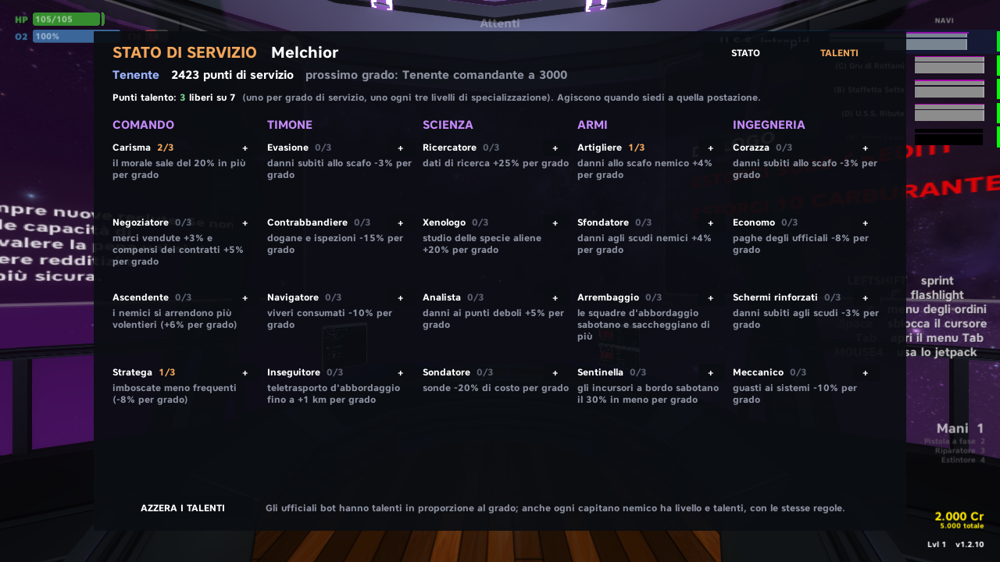

## Borsa delle merci

Dalla scheda **Mercato** del pilota si commerciano nove merci: deuterio, minerali grezzi, grano idroponico, medicinali, ricambi, elettronica, vino di Rigel e, di contrabbando, armi e reliquie aliene. Si compra e si vende solo in porto (o al cantiere di una nostra base), ma i prezzi seguono la galassia:

- ogni fazione produce alcune merci, che nel suo spazio costano poco, e ne chiede altre, che si vendono bene: la Colonial Union produce grano e chiede elettronica, la W.D. produce deuterio e ricambi e chiede minerali, l'Alleanza produce minerali, vino e armi, la Polytechnic produce medicinali ed elettronica;
- un'epidemia fa esplodere il prezzo dei medicinali, una guerra quello di armi, ricambi e deuterio, il blocco delle rotte rincara tutto; il mercato franco abbassa il prezzo del contrabbando e nella stagione delle tempeste rincarano i ricambi; le nostre miniere abbassano il prezzo dei minerali nei dintorni;
- comprare molto in un porto fa salire il prezzo, vendere molto lo fa scendere, e il mercato torna a posto in qualche salto: niente rendite infinite sulla stessa rotta;
- **l'economia è uguale per tutti**: a ogni salto i mercanti NPC fanno i loro affari fra porti vicini, comprando dove costa poco e vendendo dove rende, e muovono gli stessi prezzi che vediamo noi. Le occasioni migliori si consumano anche senza di noi (più mercanti durante il mercato franco e con un nostro emporio, meno durante il blocco delle rotte); la scheda Mercato e il notiziario raccontano gli ultimi carichi.

La scheda mostra per ogni merce quanta ne abbiamo, il prezzo d'acquisto e di vendita del porto (verde se rivenderla ora è un guadagno), quanto l'abbiamo pagata e il miglior prezzo di vendita noto altrove, con un pulsante per tracciare la rotta. I prezzi migliori si scoprono visitando i porti o ascoltando i mercanti del traffico locale, che chiamati danno consigli veri. La stiva ha 20 posti (di più con la stiva schermata del cantiere e con un nostro emporio); un carico ricco attira i predoni, che chiedono di sganciarne metà. Il contrabbando rende molto ma le dogane delle fazioni lo cercano (meno con la stiva schermata, mai durante il mercato franco, mai nello spazio dell'Alleanza), e vendere armi a un informatore costa un posto nella lista dei ricercati. Guadagnare col commercio fa crescere la vocazione di mercanti (o di corsari) e c'è un'ambizione per chi ne fa un mestiere. In console: `market`, `market buy|sell <merce> <quantità>`.

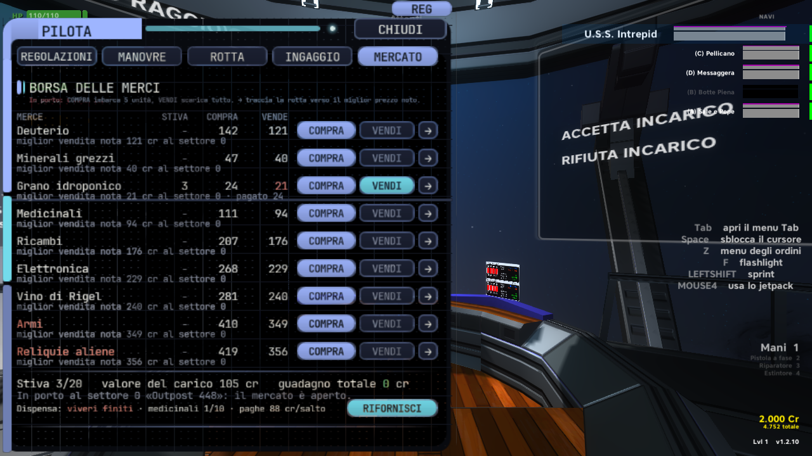

**Interni affollati.** Anche a piedi le stazioni sono piene di gente. I vagabondi del gioco camminano su percorsi validi; ognuno lascia un'orma che resta anche quando esce dalla stazione, e sulle orme camminano decine di comparse, avanti e indietro, con passo, pause e scostamenti propri, animate dal controller del personaggio. Sono comparse locali (nessun traffico di rete, nessuna IA da calcolare), create su ogni computer della partita; quante dipende dalla prosperità del porto, dalle feste (il doppio), dalle epidemie (la metà) e dalla densità del traffico. In console: `crowd`, `crowd on|off`.

**Porti vivi.** Ogni porto ha una prosperità e una sicurezza che cambiano con i commerci (nostri e dei mercanti NPC), con la guerra e con gli eventi. Nei porti entro cinque salti succedono cose: una **carenza** di una merce (la si paga quasi il triplo; chi ne porta dieci casse risolve la crisi e guadagna reputazione, onore e fama), uno **sciopero** dei portuali (mercato e rifornimenti chiusi per qualche salto), una **festa** (vino caro, licenza a terra che rialza il morale), un **blocco dei pirati** (assalti più frequenti nella zona, finché qualcuno non abbatte i predoni: il porto paga e la fazione ricorda), un **boom** economico (elettronica e vino a peso d'oro, più traffico), un'**epidemia** (medicinali carissimi, nessun candidato all'imbarco). I porti poveri pagano un po' di più, quelli prosperi attirano più navi; senza nessuno che li aiuti, carenze, blocchi ed epidemie impoveriscono il porto. La scheda Mercato mostra lo stato del porto in cui ci troviamo; il notiziario racconta gli eventi. In console: `ports`, `ports event <tipo>`.

**Commercio in volo e banca della Gilda.** I mercanti e i rifornitori del traffico hanno la loro stiva: chiamandoli, a volte propongono un trasbordo in volo, con merce a un prezzo più basso che in porto e, se abbiamo qualcosa che interessa loro, un'offerta per il nostro carico. Allo sportello della Gilda dei Mercanti, nei porti, si può chiedere un prestito (5.000 o 15.000 crediti) al 2% a salto, con quindici salti di tempo; si rimborsa in porto dalla scheda Mercato (pulsante RIMBORSA), anche a rate. Chi non paga in tempo finisce fra i ricercati e riceve la visita degli esattori della Gilda, che escono dalla curvatura armati; saldare il debito fa calmare le acque. In console: `skytrade`, `bank`, `bank borrow <crediti>`, `bank repay`.

**Ordini e fiducia dei porti.** All'attracco il capo del porto può proporci un ordine: un certo numero di casse di una merce da consegnare in un altro porto entro qualche salto (spesso proprio la merce che là manca), con un compenso che si aggiunge al prezzo di vendita. Basta vendere la merce al porto di destinazione: la scheda Mercato mostra gli ordini in corso, la rotta viene tracciata. Chi consegna guadagna la **fiducia** dei due porti; chi non arriva in tempo la perde, e spesso scopre che un equipaggio concorrente ha consegnato al posto suo. La fiducia cresce anche vendendo carichi consistenti, risolvendo carenze e spezzando blocchi: un porto che ci conosce paga un po' meglio le nostre merci, offre ordini più ricchi e, quando ci tratta da amici, ci presenta candidati più esperti. In console: `ports order`.

**Logistica di bordo.** Il viaggio costa. Ogni salto l'equipaggio consuma un'unità di viveri a testa (la dispensa ne tiene 40): sotto i tre salti di autonomia si razionano e il morale cala, finiti i viveri si fa la fame, il morale crolla e dopo qualche salto può scoppiare un ammutinamento. I medicinali (fino a 10) dimezzano i tempi dell'infermeria per gli ufficiali feriti e, durante un'epidemia, evitano che il contagio arrivi a bordo. Gli ufficiali alle stazioni dei bot vogliono la paga a ogni salto (di più per i gradi alti, meno nella rotta tranquilla): se la cassa non basta il debito cresce, il morale cala e al primo porto il meno anziano può sbarcare per protesta. La dispensa si riempie dalla scheda Mercato con **RIFORNISCI** (in porto, a prezzi che seguono quelli di grano e medicinali, usando prima il grano e i medicinali già in stiva), gratis alle nostre basi, e dalle navi del traffico: i rifornitori vendono razioni, le navi ospedale regalano medicinali. In console: `supplies`, `supplies restock`, `supplies <viveri> <medicinali>`.

## Traffico locale

Lo spazio dove ci si ferma non è più vuoto. A ogni sosta il settore si popola di navi con un mestiere, scelte da ciò che c'è intorno: mercanti e corrieri vicino ai porti, minatori fra gli asteroidi, recuperatori nei cimiteri di navi e fra i resti delle supernove, ricercatori durante la fiera dell'Accademia o un evento raro, pellegrini nella festa della tregua, navi ospedale durante un'epidemia, profughi quando la grande minaccia avanza, pattuglie nello spazio delle fazioni (più numerose sul fronte), cacciatori di taglie nella grande caccia o quando siamo ricercati, rifornitori diretti alle nostre basi. Il mercato franco porta più mercanti, il blocco delle rotte li fa sparire.

Le navi arrivano e ripartono nel tempo, salutano e chiacchierano sul canale locale (nel giornale di bordo), e vivono le loro storie anche senza di noi:

- **Assalti pirata.** I predoni piombano su un mercante, un corriere o un carico di profughi. Arriva un SOS: si può intervenire o restare a guardare. Difenderlo vale crediti, onore, morale, fama, reputazione presso la fazione del settore e una notizia nei porti; lasciarlo morire pesa sul morale; sparargli addosso fa di noi dei pirati. A volte la pattuglia di settore accorre da sola. Vicino ai covi e nella frontiera spietata gli assalti sono più frequenti.
- **Scaramucce sul fronte.** Nei settori di confine fra fazioni in guerra, un incursore attacca la pattuglia locale: schierarsi con una delle due sposta la reputazione (in su con chi aiutiamo, in giù con l'altra) e il fronte della guerra.
- **Sciacalli.** Finita una battaglia, le navi di recupero arrivano a spolpare i relitti.

**Relitti alla deriva.** Dopo una battaglia, una volta su due resta lo scafo spento di una delle navi abbattute («Relitto della …»); nei cimiteri di navi e fra i resti delle supernove ce ne sono sempre due o tre. Chiamandolo dal pannello del capitano si sceglie come esplorarlo: una **squadra d'ingegneria** (prova d'ingegneria, rischio medio), una **scansione completa** prima di entrare (prova di scienza, più dati di ricerca e meno trappole) o un **assalto rapido** (più bottino, più rischio). Dentro si trovano componenti della qualità del relitto, casse di merci per la borsa, crediti, dati di ricerca, registri di bordo con notizie fresche e, a volte, un **sopravvissuto**: se manca un ufficiale prende servizio, altrimenti lo si porta al primo porto (onore e morale). A volte è una trappola: un reattore instabile o un regalo lasciato dai vecchi proprietari manda un ufficiale in infermeria. Chi arriva tardi trova il relitto già agganciato dai recuperatori, che lo trascinano via. Statistiche «Relitti esplorati» e «Sopravvissuti salvati», achievement *Silenzio a bordo*, *Archeologo dei relitti* e *Ancora vivo*. In console: `wreck` (stato), `wreck spawn`.
- **Pattuglie e ricercati.** Con una taglia alta sulla nostra testa, le pattuglie intimano l'alt e dopo trenta secondi aprono il fuoco.

**Conoscenze.** I capitani del traffico si ricordano di noi. Chi abbiamo salvato dai predoni, scortato o aiutato con delle provviste diventa un amico: quando lo rincontriamo in un altro settore ci saluta per nome e ci fa un regalo (crediti, i suoi tecnici, le ultime voci). Chi abbiamo colpito ci tiene a distanza e racconta in giro la sua versione. Se un amico viene distrutto, l'equipaggio ne risente.

**Scorte.** Chiamando un mercante, un corriere o un carico di pellegrini, a volte chiedono una scorta fino a un settore a due o tre salti: si può accettare, rifiutare o trattare un compenso più alto. La nave ci segue di salto in salto (compare con noi in ogni settore), i predoni possono tenderle un'imboscata lungo la strada, e all'arrivo paga, ci fa guadagnare onore, fama, la vocazione di mercanti e un amico. Se viene distrutta o se ci mettiamo troppo, la scorta fallisce.

**Alleati in battaglia.** Non si combatte sempre da soli. Le pattuglie di una fazione che ci rispetta si schierano con noi quando veniamo attaccati nel loro spazio; i capitani amici presenti nel settore virano contro i nostri assalitori, e quando lo scafo è a pezzi uno di loro può raccogliere il nostro SOS e uscire dalla curvatura per saldare il suo debito; nello spazio di una fazione alleata può accorrere una pattuglia. Le basi con difese, e le fortezze, fanno decollare le loro **sentinelle** quando si combatte nel loro settore. Finita la battaglia, gli alleati salutano e ripartono. Gli scontri si allargano da soli: chi viene colpito risponde, e un'imboscata può diventare una battaglia di settore.

**Quanto affollato.** Un settore ospita da 6 a 14 navi del traffico secondo porti vicini, asteroidi, basi, fazione e prosperità del porto, con arrivi ogni 20-45 secondi e ogni tanto una carovana di mercanti con la sua scorta. Le navi civili viaggiano senza squadre di bot a bordo e con l'IA di volo nativa più lenta, perché il settore pesi meno. La densità si adatta alla macchina: sotto la soglia di fotogrammi al secondo il settore smette di riempirsi e qualche nave riparte. Si regola nella configurazione (`[Traffico] Densita` e `FpsMinimi`) o in console (`traffic density <x>`, `traffic minfps <n>`).

Chiamando una nave del traffico dal pannello del capitano, risponde secondo il suo mestiere: la nave ospedale ripara i sistemi e visita l'equipaggio, i recuperatori vendono un componente, i minatori indicano un luogo da esplorare nei dintorni, i ricercatori regalano a volte un frammento di mappa, pellegrini e profughi accettano provviste (onore e morale), mercanti e corrieri passano voci e taglie, le pattuglie indicano il covo pirata più vicino (o controllano il transponder, se siamo ricercati). Il Quadro del capitano mostra quante navi ci sono nel settore e se c'è un SOS in corso. In console: `traffic`, `traffic on|off`, `traffic <mestiere|assalto|scaramuccia|sciacalli>`.

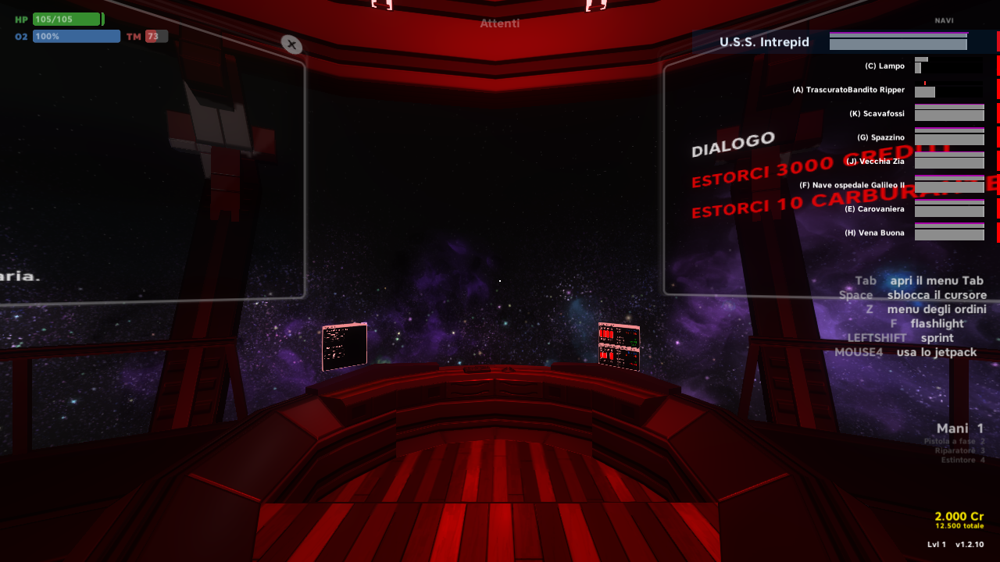

## L'IA dei nemici

Il gioco originale fa girare intorno al bersaglio ogni nave nemica alla stessa distanza, mira con un anticipo di un solo passo e fa pensare i nemici a piedi una volta ogni secondo e mezzo. Melchior, sull'host, aggiunge uno strato tattico sopra l'IA nativa, senza sostituirla.

- **Ruoli.** Ogni nave ostile è un *assaltatore* (combatte da vicino), un *fiancheggiatore* (cerca la poppa del bersaglio, lontano dai cannoni di prua) o un *cecchino* (tiene le distanze). Le navi di uno stesso gruppo si dividono gli angoli d'attacco invece di ammucchiarsi, e i piloti delle navi con equipaggio, che nel gioco tengono sempre le distanze, passano all'attacco vero quando il ruolo lo chiede.
- **Ripiegamento.** Con lo scafo malridotto e gli scudi a terra una nave rompe il contatto, ricarica gli scudi e torna all'attacco; nel giornale di bordo compare il rapporto tattico. Ai livelli alti chi ripiega può chiamare rinforzi. I droni e i personaggi ricorrenti combattono fino alla fine.
- **Mira e fuoco.** Le torrette nemiche calcolano un'intercettazione con la velocità e l'accelerazione del bersaglio, con un piccolo errore umano che si riduce ai livelli alti, e sparano più a lungo prima di fermarsi a raffreddare. Le navi nemiche usano il potenziamento per schivare.
- **A piedi.** Gli equipaggi ostili (abbordaggi, banditi, basi a terra) pensano fino a tre volte al secondo, mirano con meno tremolio, concentrano il fuoco sul bersaglio più ferito della stanza e, quando sono feriti, ripiegano verso i compagni. Torrette a terra e creature diventano più attente e più rapide.
- **Mira ai sistemi.** Gli assaltatori puntano ai generatori degli scudi, i fiancheggiatori ai motori, i cecchini alle armi; al livello più alto si accaniscono sul sistema già più danneggiato. Il giornale di bordo avverte quando una nave sceglie il suo bersaglio.
- **Personaggi ricorrenti.** Combattono secondo i loro tratti: i motori truccati ne fanno fiancheggiatori, le contromisure e la prudenza cecchini; chi ha il gusto dell'azzardo o la ferocia non ripiega mai, chi è prudente ripiega presto. I gregari fanno da scorta e cercano i fianchi.
- **Morale del gruppo.** Un gruppo che perde metà delle navi può sbandarsi: le superstiti rompono la formazione e fuggono in curvatura. L'ultima nave rimasta, malridotta, può chiedere la resa: accettarla dà il carico e onore, pretendere un riscatto dà crediti e la lascia andare, rifiutarla è una macchia d'infamia.
- **Livello tattico.** Va da 0 a 3: sale con le regole «frontiera spietata», con la grande minaccia nelle fasi finali e con la potenza dell'equipaggio; scende con la «rotta tranquilla». In console: `ai` (stato), `ai on|off`.

## Il direttore e la galassia viva

Il **direttore** gira sull'host e ogni due secondi valuta la **tensione** a bordo: nemici vicini e la loro forza rispetto alla nostra, danni recenti, scafo e sistemi malridotti. Alterna quattro fasi — **calma, allerta, crisi, respiro** — e, quando la calma dura abbastanza, sceglie un evento adatto:

- **combattimento** (solo nello spazio aperto): imboscata, sciame di droni, cacciatore di taglie, squadra della fazione rivale;
- **anomalie di bordo**: tempesta ionica, picco di plasma, interferenza subspaziale, microfratture — colpiscono proprio i sistemi gestiti dalle stazioni;
- **missione procedurale** o inizio di un **arco narrativo**.

La difficoltà segue la **potenza dell'equipaggio**, calcolata da livello, persone a bordo (giocatori e bot) e rarità media dell'equipaggiamento: cambiano i tipi di nave, il loro numero e i modificatori (da *trascurata* e *vulnerabile* fino a *corazzata*, *brutale*, *d'élite*). Gli eventi recenti diventano meno probabili, per non ripetersi.

**Fazioni rivali.** Ogni galassia ha una forza ostile generata dal server, con nome, capo e carattere (per esempio *Flotta del Sole Spento*, guidata dal *Comandante Kor*). Cresce col **tempo reale** anche quando nessuno gioca, si indebolisce quando la sconfiggete e si rafforza se fuggite. Con il rancore alto arriva il capo in persona; se cade, un successore prende il comando e giura vendetta. Al rientro in partita l'equipaggio riceve i **rapporti d'intelligence** arrivati nel frattempo.

---

## Una galassia che vive da sola

La galassia non aspetta l'equipaggio: si muove per conto suo, anche mentre nessuno gioca, e l'equipaggio ci entra dentro invece di esserne il centro.

**Guerra fra fazioni.** Unione Coloniale, Alliance of Gentlemen, W.D. Corporation, Polytechnic e Infetti si contendono i settori di confine. Ogni fazione ha uno *slancio* che cresce con le vittorie, cala con le sconfitte e ogni tanto esplode in un'**offensiva** su più settori. Le conquiste cambiano davvero il colore dei settori sulla **mappa stellare**, per tutti i giocatori, e restano nel salvataggio. I contratti eseguiti per una fazione la rafforzano sul fronte. Il settore in cui vi trovate, la destinazione del salto, i negozi e i luoghi delle missioni non cambiano mai padrone sotto i vostri piedi.

**Flotte con un'agenda.** Convogli mercantili viaggiano fra settori lontani, pattuglie delle fazioni presidiano il fronte, predoni danno la caccia ai convogli. Sono navi vere del gioco che si spostano di settore in settore: se due flotte si incontrano lontano da voi lo scontro si risolve da solo (un convoglio assaltato, una pattuglia che annienta i predoni) e finisce nel notiziario, a volte con una taglia sulla bacheca; se una flotta entra nel vostro settore, ve la trovate davanti.

**Bacheca dei contratti.** Al posto di missioni imposte, il capitano sceglie fra offerte con **committente** (le fazioni della galassia e tre indipendenti: Gilda dei Mercanti, Comando di Flotta, Accademia delle Scienze), **compenso**, **rischio** e **scadenza** in salti. Le richieste urgenti del direttore pagano di più e scadono prima. Ogni contratto onorato aumenta la **fiducia** del committente, che migliora le offerte successive; uno mancato la fa scendere. Se il capitano è un bot, sceglie lui l'offerta migliore.

<table>
<tr>
<td>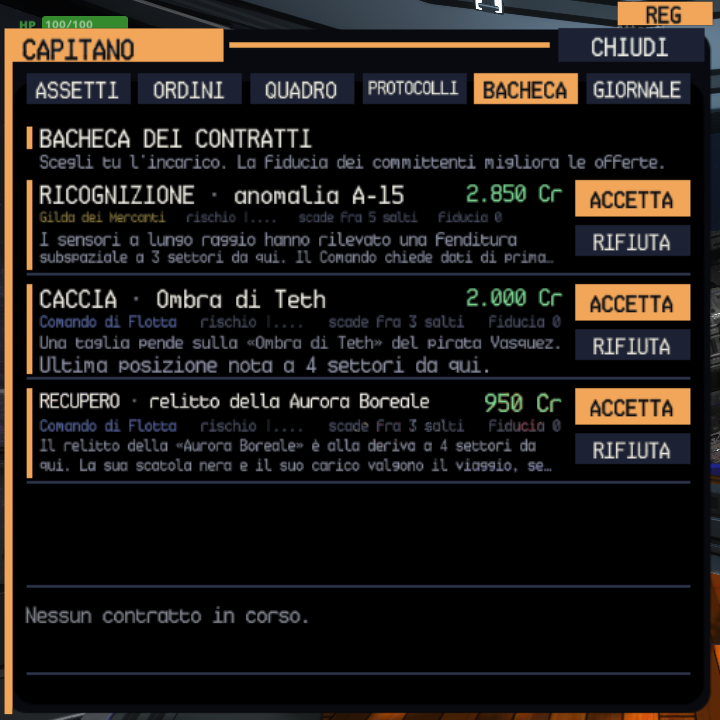</td>
<td>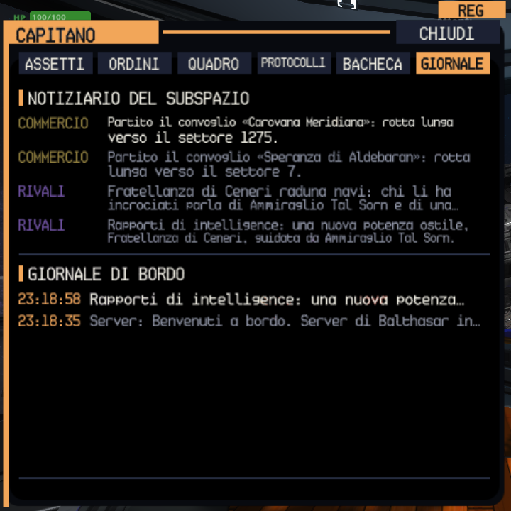</td>
</tr>
<tr><td align="center">Bacheca dei contratti</td><td align="center">Notiziario del subspazio e giornale di bordo</td></tr>
</table>

**Notiziario del subspazio.** Notizie per categoria — fronte, commercio, flotta, rivali, taglie, scienza, dicerie — costruite sui fatti veri della partita e su dicerie. Alcune dicerie sono fondate e si trasformano in un'offerta sulla bacheca.

**Il tempo passa davvero.** La cronaca ricorda quando la galassia è stata giocata l'ultima volta. Al rientro arriva un riassunto: il fronte è avanzato in proporzione alle ore trascorse («Infetti +10 settori, Alliance of Gentlemen −11»), sono maturate notizie nuove, e la fazione rivale è cresciuta sul server.

### Reputazione, personaggi ricorrenti e crisi

**Reputazione presso le fazioni.** Ogni fazione giudica l'equipaggio su una scala da −100 a +100, in sette livelli: *guerra aperta, ostilità, diffidenza, neutralità, cordialità, alleanza, leggenda*. Sale con i contratti onorati e con le crisi risolte; scende con i contratti mancati, lavorando per i nemici della fazione e aprendo il fuoco sulle sue navi. Le conseguenze sono concrete:

- **prezzi**: il mod guida la reputazione nativa del gioco, che decide i prezzi dei negozi del settore (fino a −40% presso chi vi venera, fino a +65% presso chi vi odia) e viene sincronizzata a tutti i giocatori; il gioco originale non la salvava, ora resta nella cronaca della galassia;
- **intercettazioni**: nello spazio di una fazione ostile il direttore manda pattuglie che vi intimano di fermarvi (o che, in guerra aperta, sparano senza avvisare); con la reputazione dell'equipaggio rivelata dal pannello Comunicazioni anche le navi native diventano ostili;
- **rifugio**: nello spazio di una fazione alleata la calma dura di più e, all'arrivo, una stazione amica ripara lo scafo e fornisce crediti;
- **lavoro**: chi vi considera nemici non vi offre contratti; chi vi stima paga di più.

**Personaggi ricorrenti.** Nella galassia girano sempre quattro nomi noti nei porti — *pirati*, *trafficanti* e *comandanti ribelli* di una fazione — con un soprannome, un grado da 1 a 5 e due tratti che cambiano la loro nave (corazzatura pesante, ferocia, motori truccati, gusto dell'azzardo, contromisure antimissile, gregari fedeli, capsula sempre pronta, memoria lunga). Si spostano di settore in settore, compiono imprese raccontate dal notiziario e salgono di grado. Quando vi incontrano vi salutano ricordando l'ultima volta:

- se fuggite in curvatura, se ne vantano nei porti e diventano più forti;
- se abbattete la loro ammiraglia possono salvarsi in una **capsula**: tornano con un nuovo soprannome («Mezzafaccia», «Fenice», «Due Volte»…), un grado in più e il rancore di chi è stato umiliato; alla terza volta non c'è capsula che tenga;
- se muoiono, spesso qualcuno al loro fianco ne **raccoglie l'eredità** e giura vendetta contro la vostra nave.

Le **taglie** compaiono sulla bacheca (anche da una diceria fondata del notiziario) con l'ultima posizione nota: accettata una taglia, la **rotta viene tracciata sulla mappa stellare** per tutto l'equipaggio e si aggiorna se il bersaglio si sposta. Arrivati nel settore, il bersaglio si fa vedere.

**Crisi galattiche.** Ogni otto-quattordici salti la galassia entra in una crisi in tre fasi:

| Crisi | Cosa succede | Come aiutare | Se nessuno interviene |
|---|---|---|---|
| **Epidemia** | Gli Infetti dilagano da un focolaio | Bonificare il focolaio (rotta tracciata), abbattere navi infette, contratti di soccorso | Gli Infetti si prendono i settori intorno |
| **Guerra aperta** | Due fazioni confinanti rompono la tregua | Schierarsi: contratti per una parte, navi dell'altra abbattute | Vince la più forte, con o senza di voi |
| **Corsa all'anomalia** | Un segnale sconosciuto da un settore lontano | Arrivare per primi e tenere il campo contro le spedizioni di fazione | Una fazione si prende la sorgente e ne esce rafforzata |
| **Blocco delle rotte** | I predoni raddoppiano, i convogli restano nei porti | Contratti della Gilda, flotte di predoni disperse | Le colonie restano senza rifornimenti |

Risolvere una crisi porta un pezzo raro, onore e riconoscenza; anche durante l'assenza dei giocatori le crisi avanzano di fase.

**Capi delle fazioni.** Ogni fazione ha un capo con nome e titolo (il presidente del Consiglio coloniale, il Gran Maestro dell'Alleanza, l'amministratore delegato della W.D., il rettore del Politecnico) e un carattere: falco, colomba, pragmatico dei commerci o zelota. Il carattere orienta il mondo: i falchi irrigidiscono la diplomazia e spingono la guerra, le colombe la distendono, i mercanti apprezzano chi porta merci nei loro porti, gli zeloti chi combatte gli Infetti. Ogni capo ha un'opinione di noi, che segue la reputazione e ciò che il suo carattere apprezza, e un sostegno interno che segue le sorti della guerra: se crolla arriva un colpo di stato, e comunque col tempo il vertice cambia. Con una buona reputazione il capo ci riceve in **udienza** nei suoi porti e affida un incarico secondo il suo carattere (abbattere navi nemiche, rifornire i suoi porti, abbattere navi infette, portare un messaggio di pace alla fazione rivale), che vale crediti, reputazione, fama e un'onorificenza nella sala dei trofei; da grandi amici i contratti della fazione rendono di più. La banca dati presenta il capo di ogni fazione; il Quadro mostra l'incarico in corso. In console: `leaders`, `leaders audience`, `leaders coup <fazione>`.

### Incontri con scelta, esplorazione e spirito dell'equipaggio

**Incontri con scelta.** Arrivando in un settore aperto, attraccando in un porto o durante la calma, capita qualcosa che il capitano deve decidere dalla **Bacheca**: un mercantile in avaria con bambini a bordo, una capsula alla deriva che potrebbe essere un'esca, un disertore che chiede asilo, contrabbandieri, un'ispezione di fazione, una sonda sconosciuta, una stazione abbandonata, un ammutinamento, una battaglia sul fronte in cui scegliere da che parte stare, un mercante errante, un personaggio ricorrente ferito da salvare o finire. Ogni fazione ha i suoi incontri tipici (un ricevimento formale dell'Alliance of Gentlemen, un prototipo della W.D., un esperimento della Polytechnic, una richiesta della Colonial Union, nubi di spore nello spazio infetto).

- Alcune opzioni richiedono **qualcuno alla stazione giusta** — [SCIENZA], [ARMI], [INGEGNERIA], [PILOTA] — con i sistemi in ordine, oppure crediti, alleanze, onore o una fama di spietatezza. Quelle non disponibili restano visibili e dicono perché.
- Alcuni incontri hanno una **manovra combinata** che richiede due stazioni insieme — [SCIENZA+PILOTA], [INGEGNERIA+ARMI], [SCIENZA+INGEGNERIA]… — e dà l'esito migliore e più sicuro: scansionare una capsula sospetta con i cannoni puntati, avvicinarsi in silenzio a un segnale di soccorso, entrare nel relitto più grande di un campo di battaglia, leggere la memoria di una sonda aliena. Più persone (o ufficiali) alle stazioni, più strade possibili.
- Ogni opzione ha **esiti probabili** che toccano crediti, bottino, scafo e sistemi, reputazione, onore e infamia, personaggi ricorrenti e crisi in corso.
- Alcune scelte hanno **seguiti** che arrivano qualche salto dopo: i cacciatori di taglie che reclamano il disertore accolto, la colonia fondata dai profughi scortati, i legittimi proprietari della merce di contrabbando, un naufrago che ricambia con una pista.
- Se il capitano è un bot decide lui; se nessuno risponde entro due minuti si sceglie l'opzione più prudente.

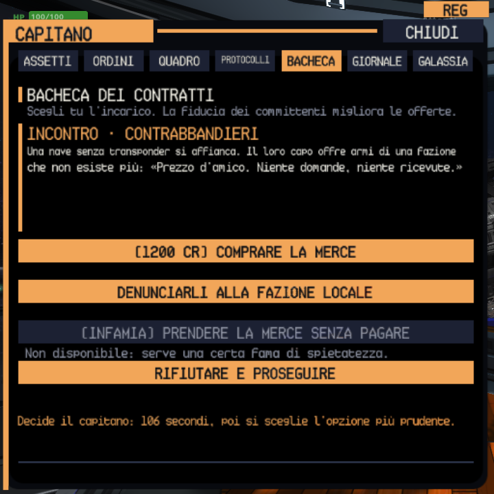

**Commercio e contrabbando.** Sulla bacheca compaiono anche **trasporti**: medicinali, parti di ricambio, colture idroponiche, celle di energia da consegnare a un porto lontano entro un certo numero di salti, per una fazione o per la Gilda dei Mercanti. Accettato il contratto, la rotta viene tracciata e la consegna avviene all'arrivo. Il carico attira i predoni (più imboscate, e capi predoni che pretendono di sganciarlo). Chi ha una certa infamia riceve più spesso offerte di **contrabbando** da un intermediario anonimo: armi senza matricola, reperti trafugati, dati militari rubati. Pagano quasi il doppio, ma nello spazio delle fazioni arrivano i **controlli doganali**: si può aprire la stiva (carico confiscato, multa, reputazione in calo), corrompere il doganiere, schermare la stiva dall'Ingegneria o spezzare il raggio traente col Pilota.

**Ambienti stellari.** Circa un settore aperto su tre ha condizioni proprie, sempre le stesse per galassia e settore, annunciate all'arrivo e indicate nella scheda Quadro. Agiscono finché si resta nel settore e le stazioni presidiate le attenuano:

| Ambiente | Effetto | Chi lo attenua |
|---|---|---|
| Nebulosa ionica | Sensori disturbati, ma le imboscate tardano | Scienza |
| Campo di asteroidi | Piccoli impatti sullo scafo; l'Ingegneria raccoglie minerali | Pilota |
| Radiazioni stellari | Supporto vitale danneggiato se gli scudi sono bassi | Ingegneria |
| Tempesta di plasma | Scudi che si scaricano, nucleo sotto stress | Scienza |
| Pozzo gravitazionale | Motori e curvatura sotto sforzo | Pilota |
| Corrente subspaziale | Motori e curvatura si riprendono da soli | — |
| Quiete assoluta | Riposo: piccole riparazioni, morale in salita, più calma | — |

**Meraviglie e cataclismi.** Ogni 25–40 salti succede qualcosa che si vede una volta in una generazione. Una **supernova**: la stella di un settore esploderà fra tre salti, e su un suo pianeta c'è una colonia senza navi — arrivare in tempo per evacuarla vale onore, morale e un trofeo; dopo l'esplosione il settore resta per sempre un campo di radiazioni, con i resti della stella da esplorare. Una **cometa errante** che attraversa la galassia di settore in settore per otto salti (le sonde la seguono): raggiungerla permette di raccogliere materia esotica dalla coda, o semplicemente di fermarsi ad ammirarla. Un **allineamento subspaziale**: per qualche salto motori e curvatura si rigenerano da soli, il morale sale e il direttore concede più calma. Un'**ondata di spazio morto**: per qualche salto i sensori si accecano (meno con qualcuno alla Scienza) e le imboscate si moltiplicano. L'evento in corso compare in alto nella scheda Giornale e nella banca dati.

**Annali della flotta.** Le imprese maggiori di ogni equipaggio — una grande minaccia sconfitta, un luogo leggendario raggiunto, un'onorificenza, il primo accordo con una specie aliena, un nemico temuto abbattuto, una casa resa prospera — vengono registrate per sempre su Balthasar. Nelle galassie nuove quegli equipaggi diventano leggenda: nei porti si racconta ancora delle loro navi, la banca dati li ricorda, e a volte si trova alla deriva il **relitto di una leggenda**, a cui rendere gli onori (con un trofeo), di cui recuperare il diario di bordo con la Scienza, o da smontare senza troppi scrupoli. Ogni partita lascia un segno in quelle che verranno. Il pannello di Balthasar mostra gli annali nella sezione Galassie.

**Nomi dei settori.** Ogni settore ha un nome proprio, sempre lo stesso per galassia: quello del gioco quando esiste, altrimenti uno generato — «Mivael III», «l'Abisso di Casrin», «il Cuore di Galran». Notizie, contratti, sonde, crisi, taglie e diario lo usano insieme al numero («settore 415 «il Cuore di Galran»»), così la galassia ha una geografia da ricordare e i settori restano ritrovabili sulla mappa stellare.

**Sonde di ricognizione.** Nella nuova scheda **Sonde** della Scienza si lancia una sonda (150 crediti, un minuto di ricarica) che esamina gli otto settori più vicini e riferisce cosa c'è: la fazione che li controlla, i porti, gli ambienti, i luoghi ancora da esplorare, le flotte in transito, i covi, i personaggi ricorrenti, la crisi in corso, il luogo leggendario, il cuore della minaccia, la vostra casa. Le righe che meritano una visita sono evidenziate, e accanto a ognuna c'è il pulsante per tracciare la rotta. Si sceglie dove andare invece di saltare alla cieca.

**Ricercati.** Ogni punto di infamia e ogni fazione che diventa ostile alzano la taglia sulla vostra testa: un livello di **ricercati** da 0 a 5, indicato in rosso nella scheda Galassia. A ogni livello il direttore manda **cacciatori di taglie** più numerosi e meglio armati, che vi intercettano annunciando la cifra. La taglia cala piano a ogni salto; in porto un funzionario offre di **saldare i conti** — per intero, trattando uno sconto (che a volte non viene registrato), o facendo valere il vostro buon nome. È il contrappeso del gioco da canaglie: la vita del corsaro rende, ma non è mai tranquilla.

**Sfida della settimana.** Ogni lunedì Balthasar propone una sfida, la stessa per tutti gli equipaggi che giocano sulla rete di casa: abbattere o catturare personaggi ricorrenti, esplorare luoghi, portare a termine contratti, risolvere una crisi, completare consegne, sopravvivere ai combattimenti, ottenere rese. Il mod segue i progressi dell'equipaggio, li invia al server e, a traguardo raggiunto, consegna il premio (crediti, un pezzo raro, fama, morale e un trofeo). La sfida e chi è in testa compaiono in fondo alla scheda Giornale; la classifica della settimana è nella sezione Classifiche del pannello di Balthasar.

**Covi dei pirati.** I pirati e i trafficanti di grado alto mettono su un **covo** in un settore — il Nido, la Tana, l'Approdo Nero… — e lo fortificano col tempo (da uno a cinque livelli di difese). Finché i covi resistono i predoni sono più numerosi e i convogli della zona cambiano rotta. Sulla bacheca compaiono contratti di **assalto**, con la rotta tracciata: all'arrivo le difese del covo vi vengono incontro, e se il capo è in zona c'è anche lui. Espugnare il covo vale il compenso del contratto, il bottino dei magazzini, un trofeo, e costa un grado al suo capo; se il capo esce di scena, il covo resta vuoto.

**Basi e atti di fondazione.** Come nei vecchi mondi online, un pezzo di galassia può diventare vostro. Gli **atti di fondazione** si comprano all'ufficio del catasto dei porti, oppure arrivano come ricompensa: dalle campagne delle fazioni, dai covi espugnati, dai luoghi leggendari, dalla vittoria sulla grande minaccia. Ci sono sei tipi di base: l'**avamposto minerario** rende crediti a ogni salto (il doppio in un campo di asteroidi o vicino a un giacimento); l'**emporio** rende di più nello spazio amico e guadagna sulle flotte che passano; il **laboratorio** rende più frequenti i frammenti di mappa e frena la grande minaccia (il doppio in una nebulosa); il **cantiere privato** ripara la nave da cima a fondo a ogni visita e funziona come un cantiere navale scontato; la **fortezza** scoraggia imboscate e cacciatori nei settori vicini e cancella parte della taglia sulla vostra testa; il **faro** fa partire da solo una sonda all'arrivo, perché i rapporti dei settori intorno arrivino prima. Si fonda dalla scheda **Basi** dell'Ingegneria, fermi in un settore libero: spazio aperto, nebulose, campi di asteroidi, cimiteri di navi, ma non porti, missioni, covi, crisi o il cuore della minaccia. Le fazioni ostili non lasciano costruire nel loro spazio, quelle neutrali chiedono una licenza. Il cantiere dura tre salti; poi la base si migliora fino al livello 3 e si fortifica fino a tre livelli di difese, sempre sul posto. Ogni base costa manutenzione e consuma scorte: tornarci le rifornisce, e sulla bacheca compaiono contratti di trasporto per portarle rifornimenti. Le basi vengono **assalite**: con buone difese resistono da sole, altrimenti bisogna tornare e combattere accanto alle loro torrette; se cadono, perdono un livello o vengono rase al suolo. Al massimo sei basi per galassia, con la vocazione «Coloni della Frontiera» per chi ne fa un mestiere; le basi compaiono nella banca dati, nelle ambizioni e nella console di amministrazione.


**Porto di casa.** A un attracco il capo del porto può proporvi di fare di quel posto la vostra **casa**. Tornarci significa riposo (molto morale), riparazioni gratuite, sistemi rimessi a posto e infermeria vuota. La casa ha una **prosperità** che cresce con le consegne fatte lì, con i contributi (crediti o squadre tecniche prestate per i lavori) e con le difese riuscite; a ogni livello offre di più: lo sconto del cantiere di casa, una decima a ogni ritorno, veterani pronti a imbarcarsi (i nuovi ufficiali non partono più da guardiamarina), e un trofeo quando diventa davvero prospera. Ogni tanto la casa viene **assalita** dai predoni e chiede aiuto, con la rotta tracciata: arrivare in tempo e respingerli vale prosperità, morale, onore, fama e un regalo; non arrivare in tempo significa trovarla saccheggiata.

**Specie aliene e primo contatto.** Ai margini della galassia vivono quattro specie che nessun archivio conosce: i **Vel'nari**, esseri di luce che sentono le emozioni e non sopportano la menzogna; i **Kethri**, mercanti insettoidi per cui ogni scambio è un rito; gli **Ossidiani**, cristalli vivi che pensano in secoli; il **Coro di Tessa**, una mente collettiva fatta di canto. Il **primo contatto** è un incontro: il protocollo della Scienza, un saluto sulle frequenze standard (che può essere frainteso), le armi spianate o una ritirata silenziosa. Poi tornano a farvi visita: si studia la loro lingua con la Scienza, si scambiano doni, si chiede la loro tecnologia (se vi stimano abbastanza). Ogni specie ha una **comprensione** e un **atteggiamento** verso di voi; se l'atteggiamento crolla, vi sbarrano la strada chiedendo una riparazione. Con comprensione piena e un buon rapporto si firma un **accordo**, il primo nella storia della galassia: trofeo, fama e un vantaggio unico — i consiglieri dei Vel'nari dimezzano i colpi al morale, i Kethri vi fanno prezzi da soci al cantiere e al mercato nero, gli Ossidiani rinforzano lo scafo con piastre di cristallo, il Coro vi avverte delle imboscate prima che scattino.

**Banca dati di bordo.** La nuova scheda **Banca dati** della Scienza è un'enciclopedia che si riempie giocando, sfogliabile da chiunque per categoria: le **fazioni** con la loro storia e i rapporti con voi, le **specie** aliene contattate, i **personaggi** ricorrenti incontrati con una biografia scritta dalle loro imprese e dagli scontri con la vostra nave, i **luoghi** esplorati e leggendari, le **reliquie** leggendarie passate per la vostra stiva con la loro storia, i **fenomeni** stellari attraversati, gli **equipaggi** concorrenti conosciuti, la **grande minaccia**.

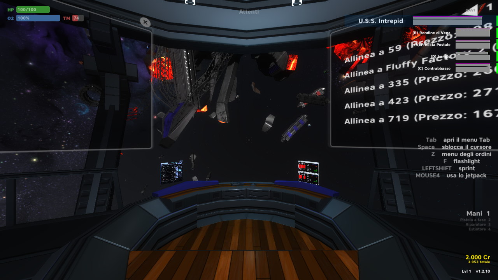

**Il traditore a bordo.** Dopo un po' di viaggio, uno degli ufficiali può cominciare a lavorare in segreto per una fazione ostile o per un equipaggio concorrente: guasti inspiegabili nei momenti peggiori, imboscate più frequenti, come se qualcuno conoscesse la vostra rotta. Ogni sabotaggio lascia un indizio, e con abbastanza indizi parte un'**indagine**: gli indizi puntano a due o tre ufficiali, la Scienza può cercare altre prove per restringere i sospetti, e alla fine qualcuno va accusato. Il traditore smascherato lascia la nave in manette (trofeo e molto morale); un innocente accusato se ne va offeso, e i sabotaggi continuano.

**Vita di bordo.** Ogni tanto, ovunque ci si trovi (anche in porto, mai in combattimento), succede qualcosa a bordo, e il capitano decide dalla Bacheca: due ufficiali che litigano per la precedenza sull'energia, il compleanno di un ufficiale, un ragazzino clandestino scoperto in stiva che sogna di fare il pilota, il replicatore di cibo guasto, una febbre misteriosa, la nostalgia di casa dopo troppi salti senza porto (con la rotta verso il porto più vicino), un torneo di scacchi tridimensionali, una promozione straordinaria contesa fra due ufficiali dello stesso grado. Gli eventi usano i nomi veri degli ufficiali e toccano morale, carriere, infermeria e fama.

**Chiamate al bersaglio.** Nella scheda **Ordini** il capitano può chiamare la nave agganciata. A una nave non ostile si **chiedono notizie**: voci di porto, piste che diventano taglie, tracce di luoghi nei settori vicini (le navi delle fazioni alleate a volte mandano anche una squadra di riparazione; quelle ostili non rispondono). A una nave nemica si **intima la resa**: riesce più spesso se è malridotta e se l'equipaggio è forte o famigerato, meno con i personaggi ricorrenti di grado alto o dalla memoria lunga. Chi si arrende abbandona la nave nelle capsule e lascia il carico, senza vittime. Un personaggio ricorrente che si arrende diventa **prigioniero**: lo si consegna alle autorità (ricompensa e trofeo), si chiede un riscatto alla sua banda (tornerà con un conto da regolare) o lo si lascia andare (tornerà in debito con voi).

**Cantiere navale.** In porto, la nuova scheda **Cantiere** dell'Ingegneria vende migliorie permanenti in tre livelli (3.000, 7.000 e 14.000 crediti): **scafo rinforzato** e **generatori schermati** (+8% di scafo o scudi per livello, su ogni macchina della partita), **stiva schermata** (meno ispezioni doganali e meno predoni attirati dal carico), **sensori a lungo raggio** (all'arrivo segnalano i luoghi da esplorare nei settori vicini, dal secondo livello anche gli ambienti, e rendono più frequenti i frammenti di mappa), **motori ottimizzati** (asteroidi, pozzi gravitazionali e tempeste di plasma pesano meno), **infermeria** (ufficiali feriti più di rado, guariti prima, quasi mai perduti) e **alloggi migliori** (il morale regge i lunghi viaggi e la licenza a terra rende di più). Una nave completamente rimodernata vale un trofeo.

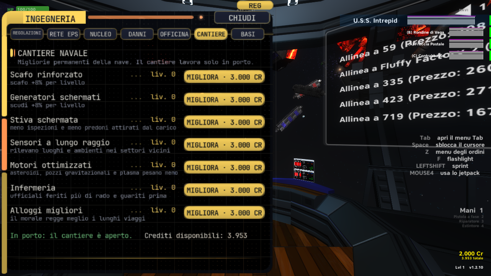

**Campagne delle fazioni.** Chi conquista l'alleanza di una fazione viene convocato per la sua campagna in tre atti: la **Operazione Bastione** della Colonial Union (difendere le colonie di frontiera), il **Codice dei Gentiluomini** dell'Alliance of Gentlemen (un cimelio rubato e un figlio diseredato), l'**Acquisizione Ostile** della W.D. Corporation (un prototipo sottratto e un segreto scomodo), il **Progetto Aurora** della Polytechnic (un esperimento da proteggere dai sabotatori). Il primo atto è una battaglia in un settore indicato, con rotta tracciata; il secondo un dilemma che può anche chiudere la campagna (far trapelare i segreti della W.D., liberare i sabotatori); il terzo un ammiraglio nemico da abbattere oltre il confine. La vittoria vale un'**onorificenza** — la Stella del Bastione, la Croce dei Gentiluomini, il Sigillo del Consiglio W.D., la Medaglia Aurora — con un trofeo, un pezzo d'eccezione e un'alleanza che non si perde più: la reputazione presso quella fazione non scende sotto l'alleanza, e le sue navi restano amiche. Una campagna lasciata a metà per troppi salti viene affidata ad altri.

**Storie a puntate.** Oltre agli archi narrativi delle missioni, alcune storie si sviluppano attraverso gli incontri, a distanza di qualche salto, e cambiano strada secondo le scelte: **la nave fantasma** (un relitto che trasmette il vostro stesso codice di identificazione, datato fra tre settimane), **il finanziatore** (un prestito facile, poi gli esattori, poi i cacciatori di taglie se non pagate) e **l'erede** (il giovane figlio di un ammiraglio deposto, da proteggere, consegnare o riportare al potere — con la gratitudine di una fazione intera, o un ultimo tradimento). Ogni storia si gioca una volta per galassia.

**Sala dei trofei.** Ogni impresa importante lascia un trofeo con nome e data stellare: le insegne dei personaggi ricorrenti abbattuti, le reliquie dei luoghi leggendari, gli encomi delle crisi risolte, le cronache degli archi conclusi, i ricordi delle storie a lieto fine, la coppa del primo posto fra i liberi equipaggi, il frammento del cuore della grande minaccia. Il conteggio compare nella scheda Galassia, l'elenco nel pannello di Balthasar.

**Vocazione dell'equipaggio.** Nessuno sceglie una classe: l'equipaggio diventa ciò che fa. Ogni scoperta, consegna, taglia, ambasciata, carico di contrabbando o scelta onorevole conta, e il mestiere più praticato diventa il vostro nome nei porti — **Esploratori, Mercanti, Cacciatori di taglie, Diplomatici, Corsari, Guardiani della Frontiera** — in tre gradi, con vantaggi crescenti in quel mestiere: dati dell'Atlante pagati di più e frammenti di mappa più frequenti, trasporti più ricchi e dogane meno pignole, taglie più ricche e più frequenti, ambasciate più efficaci e reputazione più veloce, contrabbando più redditizio e mercato nero più generoso, più morale e fama dalle scelte onorevoli. La vocazione compare nella scheda Quadro e cambia se cambiate vita.

**Stagioni galattiche.** Ogni 15–25 salti la galassia entra per qualche salto in un periodo speciale, annunciato e indicato nella scheda Giornale: la **regata della Gilda** (sfide di velocità ovunque, premi raddoppiati), la **fiera dell'Accademia** (dati dell'Atlante a prezzo doppio, scoperte più famose), il **mercato franco** (niente dogane, trasporti pagati meglio), la **stagione delle tempeste** (anomalie di bordo più frequenti), la **festa della tregua** (la guerra rallenta, la diplomazia corre), la **grande caccia** (taglie maggiorate, personaggi ricorrenti allo scoperto).

**La grande minaccia.** Ogni galassia ha un'ombra che cresce piano — «la Marea Grigia», «il Divoratore di Stelle», «il Coro del Vuoto»… — con il tempo giocato e con le conquiste degli Infetti. Attraversa quattro fasi: prima le dicerie, poi settori che si spengono uno dopo l'altro, poi gli Infetti spinti oltre ogni fronte (e le fazioni che, per paura, si avvicinano fra loro), infine la scoperta del suo **cuore**, con la rotta tracciata. Lì aspetta una portaerei infetta d'élite con la sua scorta: abbatterla vale un pezzo leggendario, diecimila crediti, morale alle stelle e una fama che vi porta in cima alla classifica. L'equipaggio la frena contenendo le epidemie, distruggendo navi infette, raccogliendo campioni per l'Accademia (un incontro dedicato) e con le scoperte. Se la minaccia raggiunge il culmine senza essere fermata, sei settori cadono in una notte, le flotte delle fazioni vanno in rotta e la minaccia ricomincia, un po' più debole. Dopo una vittoria, col tempo, qualcos'altro si sveglierà.

**Diario del capitano e ambizioni.** Ogni galassia ha la sua **data stellare**, che avanza con il tempo giocato e con i salti. Ogni venticinque minuti circa, o prima se sono successe parecchie cose importanti, il **diario del capitano** registra una voce scritta a partire dalla cronaca vera della partita, con lo stato dell'equipaggio («Diario del capitano, data stellare 53505.1. …»). Al rientro in una galassia, **«Nella puntata precedente…»** riassume i fatti principali dell'ultima sessione. In ogni momento l'equipaggio ha tre **ambizioni** a lungo termine, mostrate nella scheda Giornale: esplorare luoghi, raggiungere luoghi leggendari, abbattere personaggi ricorrenti, portare a termine contratti, risolvere crisi, avere alleati, salire nella classifica dei liberi equipaggi, accumulare onore, riuscire nelle ambasciate. Ognuna completata vale crediti, un pezzo raro, fama e morale, e lascia il posto a un'ambizione nuova, più difficile.

**Equipaggi concorrenti.** Nella galassia non siete gli unici liberi equipaggi: ce ne sono altri tre, ognuno con nave, capitano e stile (onesti, cacciatori di taglie, spregiudicati). A ogni salto e ogni pochi minuti si prendono le offerte che lasciate sulla bacheca, riscuotono taglie sui personaggi ricorrenti (anche quella che state inseguendo, se tardate fino a ridosso della scadenza) e raggiungono i luoghi leggendari di cui avete la mappa ma che lasciate aspettare troppo. Tutti accumulano **fama** in una classifica dei liberi equipaggi, visibile in fondo alla Bacheca e annunciata quando salite di posizione: la vostra cresce con contratti, consegne, taglie, crisi risolte, scoperte e scelte onorevoli. Li incontrate anche di persona: si scambiano informazioni, si gareggia in velocità, si chiede un favore se l'amicizia è di lunga data — oppure si manomette la loro navigazione durante l'aggancio, e qualche salto dopo vengono a regolare i conti.

**Diplomazia.** Ogni coppia di fazioni ha un rapporto che si muove da solo a ogni passo della guerra: **guerra, tensione, pace, alleanza**. I nemici comuni avvicinano, i fronti lunghi allontanano, ogni tanto un incidente di frontiera o un vertice a sorpresa rimescola le carte. Trattati, armistizi, rotture e dichiarazioni di guerra finiscono nel notiziario. Sulla mappa chi è in pace o alleato non si contende i settori, chi è in guerra attacca il doppio; una dichiarazione di guerra può aprire la crisi *guerra aperta*, e alla fine della crisi resta una pace armata. Gli alleati di una fazione condividono un terzo di ciò che l'equipaggio guadagna o perde con lei. Sulla bacheca compaiono **ambasciate**: scortare l'inviato di una fazione nello spazio di un'altra migliora molto i loro rapporti (fino a far firmare una pace) — a meno che qualcuno non vi offra tremila crediti per vendere l'inviato prima che arrivi.

**Porti.** Attraccando a una stazione o a un negozio l'equipaggio va in licenza a terra, e spesso succede qualcosa: nella **taverna** si vendono all'Accademia i dati dell'Atlante non ancora venduti, si offre da bere in cambio di voci (a volte una taglia), si arruola un veterano che alza il morale; al **cantiere** si paga una revisione completa o si lavora fianco a fianco con i tecnici; al **mercato nero** si comprano pezzi rari senza domande o si prende un carico di contrabbando.

**Esplorazione.** Circa un settore aperto su quattro nasconde un luogo: relitto antico, rovine, giacimento, anomalia stabile, cimitero di navi, faro alieno, deposito nascosto. È fisso per galassia e settore, e all'arrivo la Scienza ne rileva le tracce: esplorarlo è un incontro con scelte dedicate. Le scoperte finiscono nell'**Atlante**. Fari, rovine e relitti possono dare **frammenti di mappa** (li vende anche il mercante errante): con tre frammenti si rivela un **luogo leggendario** a molti salti di distanza, con la rotta tracciata per tutti. Lì aspetta un guardiano; abbatterlo vale un pezzo **leggendario** garantito.

**Ufficiali.** Chi siede a una stazione affidata a un bot è un ufficiale con nome, grado della marina (da guardiamarina a capitano di fregata) e un tratto: sangue freddo sotto il fuoco, precisione maniacale, temperamento impulsivo, fortuna sfacciata, ambizione, esperienza di guerra. Le procedure riuscite fanno carriera, e ogni promozione rende più probabile la riuscita delle sue procedure; i rapporti nel giornale di bordo portano la sua firma («Ingegneria (TV Duarte): matrice allineata»). Quando lo scafo è a pezzi un ufficiale può finire in infermeria (per qualche salto lavora un sostituto, peggio) e, raramente, cadere in servizio: arriva un guardiamarina e il morale ne risente. Gli ufficiali compaiono anche negli incontri: chiedono una licenza per un evento di famiglia, ricevono offerte d'ingaggio da altre navi. La scheda **Quadro** mostra chi c'è a ogni stazione.

**Vite dell'equipaggio.** Ogni ufficiale ha i suoi desideri: fare scalo in un porto dove ha persone care, dare la caccia a un pirata con una taglia, vedere la cassa piena, assistere a un evento raro, tornare a casa o a una nostra base, una licenza in un porto in festa. Esaudirli fa salire la sua **lealtà** e il morale; ignorarli a lungo la fa scendere, finché non ci rinuncia con delusione. Un ufficiale fedele lavora meglio, uno scontento peggio, e se la lealtà crolla al primo porto sbarca. Le esperienze comuni creano **amicizie**, che rafforzano la lealtà; i caratteri che si scontrano (impulsivi e ambiziosi contro gli altri) creano **rivalità**, con liti in mensa che pesano sul morale, finché non si fa pace. Il Quadro del capitano mostra desideri e lealtà accanto a ogni ufficiale; la console di amministrazione anche. In console: `crewlife`, `crewlife wish`.

**Spirito dell'equipaggio.** Il morale (0–100) sale con le vittorie, le scelte onorevoli, i contratti onorati, i rifugi alleati e la **licenza a terra** quando si attracca a una stazione; scende con le fughe, i contratti mancati, le scelte crudeli, lo scafo a pezzi e i lunghi viaggi senza toccare un porto. Con il morale alto l'iniziativa del capitano cresce più in fretta e l'equipaggio ripara da sé i piccoli guasti; con il morale basso la manutenzione viene trascurata, e sull'orlo della rivolta una delegazione si presenta in plancia. La **fama** riassume onore e infamia in un titolo — da «Equipaggio rispettato» a «Leggende della Frontiera», da «Gente da evitare» a «Flagello del Margine», fino alle «Canaglie di buon cuore» — e chi vi incontra la cita.

<table>
<tr>
<td>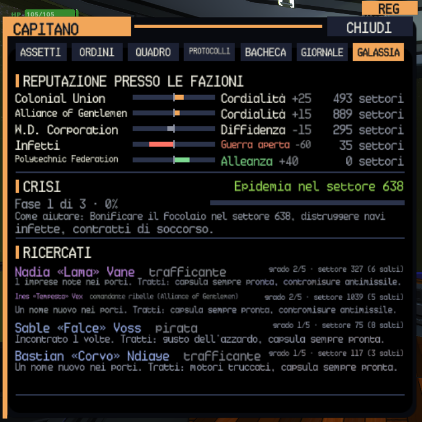</td>
<td>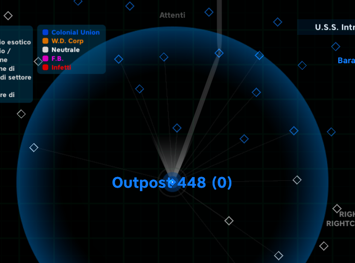</td>
</tr>
<tr><td align="center">Scheda Galassia: reputazione, crisi, ricercati, morale, Atlante</td><td align="center">Rotta tracciata verso il settore della crisi</td></tr>
</table>

Tutto vive sull'host ed è salvato su Balthasar insieme alla cronaca della galassia; la console di amministrazione lo mostra nella sezione Galassie (reputazione, crisi in corso e concluse, personaggi con grado, rancore e memoria).

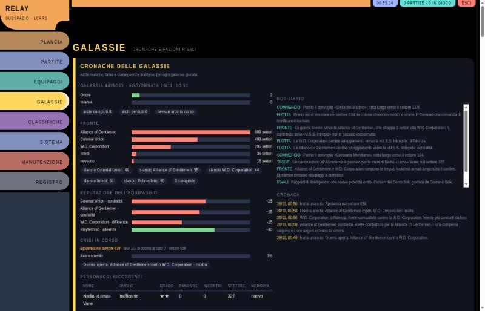

### Indagini e archeologia

La galassia ha un passato, e qualcuno l'ha lasciato in giro.

**Civiltà perdute.** Ogni galassia ha quattro o cinque civiltà scomparse, generate dal suo seme: un nome, un epiteto (*i Cantori del Vuoto*, *i Tessitori di Luce*, *la Stirpe delle Mille Lame*…), una natura, il materiale dei loro manufatti, un'epoca e il modo in cui sono finite. La loro storia è divisa in sei capitoli (origini, dono, impero, crepa, fine, eredità) che si ricostruiscono un pezzo alla volta: fari decifrati, strati scavati, reperti studiati, rovine e fari dell'Atlante. Con tutti i capitoli la civiltà è ricostruita: la Banca dati ne racconta la storia intera, l'Accademia lo annuncia nei porti e le ultime iscrizioni rivelano il loro **mondo d'origine**, l'ultimo scavo, custodito da sentinelle antiche, con un'eredità leggendaria e un trofeo.

**Segnali misteriosi.** Saltando, a volte la Scienza capta qualcosa nel rumore di fondo (più spesso con qualcuno alla stazione, con i sensori potenziati e durante un allineamento; molto di rado nello spazio morto):

- un **SOS degradato** di una nave data per dispersa, a volte con superstiti in criosonno (un ufficiale esperto che prende servizio, o passeggeri da salvare);
- il **faro** di una civiltà perduta, che indica un loro avamposto da scavare;
- una **stazione dei numeri**, la chiave di un deposito nascosto (e a volte la posizione di un covo pirata);
- un'**eco gravitazionale**, un'anomalia stabile ricca di dati, pericolosa per chi ci entra alla cieca;
- un **canto alieno**, che si può ascoltare o a cui si può rispondere;
- una **richiesta d'aiuto** troppo regolare per essere vera: un'esca dei predoni;
- molto di rado, una **trasmissione impossibile**, con il codice della nostra nave e una data sbagliata.

Per trovarne l'origine si **triangola**: a ogni salto con la Scienza in servizio si misura la direzione del segnale da un punto diverso della mappa, con un errore che dipende da chi ascolta. Due rilevamenti abbastanza distanti restringono la zona, tre la individuano; una **sonda** può bastare. Intanto lo si **decifra**, un po' a ogni salto o spendendo dati di ricerca: al 30% se ne capisce la natura, al 60% il contenuto (e se è un'esca), al 100% il messaggio intero, che all'arrivo cambia le cose (il codice d'accesso della nave, la combinazione del deposito, la forma dell'anomalia, la grammatica del canto). Chi arriva senza averlo decifrato, e va di fretta, rischia trappole e feriti. I segnali si spengono dopo dieci-quindici salti: chi tarda perde la pista. Anche le navi di ricerca dell'Accademia, chiamate dal capitano, possono affidarci un'indagine a pagamento.

**Ritrovamenti fortuiti.** Non tutto arriva da un segnale: arrivando in un settore, a volte i sensori notano geometrie troppo regolari per essere naturali (più spesso fra asteroidi, nebulose e cimiteri di navi, e con la Scienza in servizio), e le rovine scoperte con l'esplorazione dell'Atlante nascondono altri strati da scavare.

**Scavi.** Le rovine hanno tre strati. Scavare richiede tempo vero nel settore: **metodico** (circa due minuti, reperti meglio conservati) o **rapido** (meno di un minuto, qualcosa si rompe). Mentre si scava il settore non resta tranquillo: predoni attirati dal rumore delle trivelle, spedizioni rivali che vogliono il sito (si può condividerlo, pagarle perché se ne vadano, intimar loro di andarsene o gareggiare), sentinelle antiche che si risvegliano. Saltare via interrompe lo strato. Ogni strato dà reperti e un capitolo; l'ultimo a volte un frammento di mappa.

**Reperti.** Ogni reperto ha una civiltà, una rarità (da comune a leggendario), uno stato di conservazione, un valore e una piccola storia; alcuni sono **inquieti** (sussurri in stiva, guasti inspiegabili, malinconia) finché non li si studia o li si getta. Si possono **studiare** (dati di ricerca e a volte un capitolo), **donare** all'Accademia in porto (onore, fiducia dell'Accademia, fama, una targhetta nel museo), **vendere** al museo del porto o, dove la legge è debole, a un ricettatore (più crediti, infamia e l'Accademia che storce il naso), o **gettare** nel vuoto.

Tutto si gestisce dalla nuova scheda **Indagini** della Scienza: i segnali con decifrazione, rilevamenti, zona e scadenza (DECIFRA, SONDA, ROTTA), lo scavo in corso con la sua barra, i reperti a pagine con le loro azioni, i capitoli delle civiltà. Statistiche del gruppo «Indagini» e achievement *Rumore di fondo*, *Orecchio fino*, *Triangolazione*, *Prima palata*, *Collezionista*, *Storia ritrovata*, *Ritorno a casa*, *Mecenate* e due nascosti. La console di amministrazione mostra civiltà, segnali, scavi e reperti di ogni galassia. In console di sviluppo: `mistero` (stato), `mistero segnale [tipo]`, `mistero decifra`, `mistero qui`, `mistero scavo`, `mistero fine`, `mistero reperto`, `mistero capitoli`.

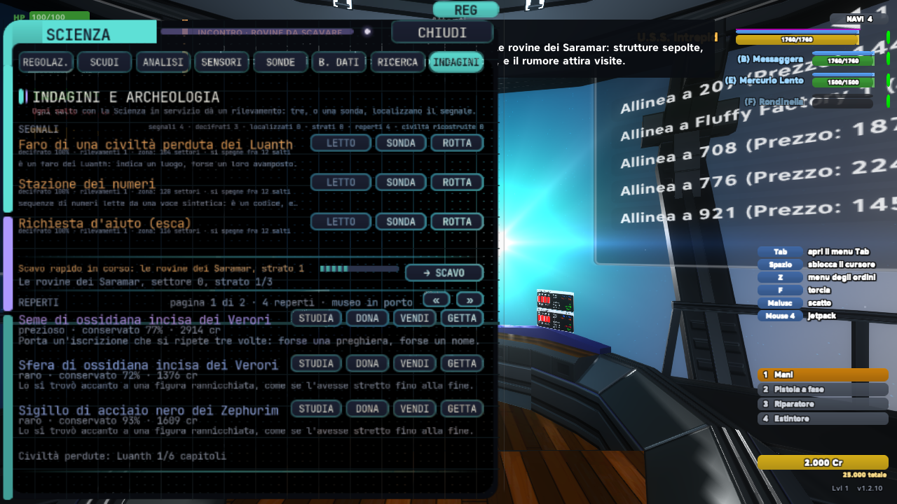

---

## Missioni procedurali

Le missioni sono costruite **dentro il sistema nativo del gioco** (le *pickup mission*): settore dedicato sulla mappa stellare, navi con nome, obiettivi e ricompense, interfaccia e sincronizzazione sono quelle originali. Il catalogo è generato in modo deterministico su ogni macchina, quindi host e client hanno gli stessi dati senza doverli scambiare.

| Famiglia | Cosa succede | Stazioni coinvolte |
|---|---|---|
| **Caccia** | Una taglia su una nave con nome; ai livelli alti anche un limite di salti | Armi, Pilota |
| **Soccorso** | Predoni attorno a una nave civile; reputazione presso l'Unione Coloniale | Armi |
| **Ricognizione** | Raggiungere un'anomalia e analizzarla con l'impulso dei sensori | Scienza |
| **Scorta** | Proteggere un convoglio mentre carica la curvatura, con ondate di predoni | Tutte |
| **Primo contatto** | Avvicinare una specie sconosciuta: scansione completa, poi ordine di silenzio; se si spara, fallisce | Scienza, Capitano |
| **Recupero** | Scansionare un relitto e recuperarne la scatola nera, poi respingere gli sciacalli; in premio un componente | Scienza, Armi |
| **Anomalia temporale** | Da una fenditura esce una copia ostile della vostra stessa nave | Tutte |
| **Evacuazione** | Tenere in piedi il supporto vitale sotto una tempesta di radiazioni | Ingegneria |
| **Interdizione** | Tre ondate di incursori entro un limite di salti | Armi, Pilota |

Ogni famiglia ha 5 livelli di difficoltà e 6 varianti, con nomi, luoghi e personaggi propri: **270 missioni**, più le **300 parti** degli archi narrativi.

---

## Archi narrativi e conseguenze

Gli **archi** sono storie in tre parti con gli stessi personaggi, in cui l'esito di una parte decide la successiva:

- **Il silenzio** — un segnale antico, il primo contatto; se va bene si scorta l'ambasciata, se va male arriva la rappresaglia.
- **La taglia** — il luogotenente di un fuorilegge, il relitto con la rotta per il covo, l'ammiraglia del capo.
- **La caduta** — una colonia chiede aiuto, va evacuata, i profughi vanno scortati in un porto sicuro.

**Onore e infamia** cambiano con gli esiti e spostano gli eventi del direttore: con più infamia arrivano più cacciatori di taglie e rivali, con più onore più richieste di missione. Qualche salto dopo una missione arrivano le **conseguenze ritardate**: la gratitudine di chi avete salvato (crediti), la vendetta degli amici di chi avete abbattuto, la rappresaglia dopo un contatto fallito, una scatola nera che apre un nuovo arco, un paradosso temporale. Tutto è salvato sul server, galassia per galassia, e prosegue fra una sessione e l'altra.

---

## Bottino, obiettivi e carriera

**Obiettivi e statistiche della galassia viva.** Venticinque obiettivi nuovi, con icone in stile LCARS, seguono i sistemi aggiunti: commercio (fiuto per gli affari, magnate della Frontiera), porti (carenze risolte, blocchi spezzati), traffico (angelo custode, scorte d'onore, amici in ogni porto, ora di punta), abbordaggi (all'arrembaggio, flagello delle stive, incursioni respinte), ricerca (eureka, tutte le tecnologie), basi (prima pietra, cittadella, impero di frontiera), capitani NPC (caccia grossa), talenti (maestria), reclutamento, equipaggi concorrenti, rese, case produttrici e qualità dell'equipaggiamento. Tredici statistiche nuove nello stato di servizio (gruppo «Galassia viva») danno punti per il grado e la classifica di rete; le configurazioni esistenti le ricevono da sole.

**Ogni esemplare è diverso.** Dal grado Raffinato in su un componente porta la firma di una delle dodici **case produttrici** (Kessler Dynamics, Cantieri Okafor, Vega Precision, Officine Lindqvist, Moreau & Figli, Sato Kinetics, Ilves Scientific, Barros Salvage, Mercanti di Navarro, Arsenale della Frontiera, Fluffy Biscuit Co., Polytechnic Labs), ciascuna con un motto, uno stile (il primo affisso viene spesso dai suoi preferiti: potenza grezza, scafi robusti, precisione, ricerca, commercio, recupero…) e un prestigio che pesa sul prezzo. Ha un nome di modello («Fenice», «Vigile», «Rondine»…), un numero di serie e una **qualità** (quanto i suoi valori si avvicinano al massimo possibile, fino al 125% per gli instabili), che pesa anch'essa sul prezzo. Tutto è calcolato dall'identità dell'oggetto, quindi ogni giocatore vede lo stesso esemplare senza traffico di rete in più. Quattordici affissi nuovi legano l'equipaggiamento alla galassia viva: prezzi di vendita, posti in stiva, dati di ricerca, bottino e sabotaggi negli abbordaggi, difesa dagli incursori, viveri, dogane, furtività, fama, morale, recupero dai relitti, costo delle sonde; e due difetti nuovi (un faro per i pirati, una stiva rumorosa alle dogane). Otto leggendari nuovi li portano all'estremo: la Bilancia di Navarro, il Cuore di Barros, il Mantello del Fantasma, l'Uncino di Morgan, la Serra di Ceres, l'Occhio di Ilves, la Corona dei Moreau, la Paratia di Okafor. Le configurazioni già esistenti ricevono da sole i nuovi affissi e leggendari.

**Equipaggiamento personale.** Lo stesso sistema vale per ciò che si porta addosso: pistole, fucili, armi a raggio, granate, attrezzi di riparazione, estintori, scanner, siringhe, armature e jetpack hanno un grado, una casa produttrice, un modello, un numero di serie, una qualità e affissi propri (danno e colpi critici per le armi; riparazioni di bordo, dati di ricerca, prezzi di vendita, morale e fortuna per gli attrezzi; corazza personale, morale e fama per armature e jetpack; potenza per le granate; difetti per gli instabili). In rete questi oggetti viaggiano senza spazio per dati in più, quindi rarità e affissi si calcolano dall'identificativo di rete che ogni oggetto ha, uguale su tutti i computer: ogni esemplare è unico e tutti lo vedono uguale (dopo il caricamento di una partita salvata gli identificativi possono cambiare, e con loro gli esemplari). Vale anche per i nemici: gli equipaggi ostili hanno armi e armature con il loro grado. Danni e critici si applicano al tiro, la corazza ai danni subiti da qualunque pedina; i bonus d'equipaggio (fortuna nel bottino, commercio, ricerca, morale, fama, riparazioni) si sommano su tutti a bordo, bot compresi. Due obiettivi nuovi premiano chi porta con sé un pezzo di grado Prototipo o leggendario. In console: `gear`.

**Gradi di rarità.** Ogni componente della nave ha uno di otto gradi, ciascuno con il suo colore:

| Grado | Colore | Livelli nascosti | Affissi | Note |
|---|---|---|---|---|
| Standard | grigio | — | — | |
| Raffinato | verde | — | 1 | |
| Avanzato | blu | +1 | 2 | |
| Sperimentale | viola | +1 | 2 | da qui i ritrovamenti vengono annunciati |
| Prototipo | arancio | +2 | 3 | |
| Reliquia | oro | +2 | 3 | |
| Anomalo | ciano | +3 | 4 | instabile: spesso un difetto, ma affissi più forti del 25% |
| Leggendario | rosso | +4 | — | pezzo unico con nome, storia ed effetti propri |

Il grado viaggia dentro l'identificativo del componente, quindi sopravvive a salvataggi, negozi e rete, e ogni macchina ricalcola gli stessi affissi.

**72 affissi, di quattro tipi.**

- **Statistici** — potenza e calore del reattore, refrigerante, scudi (capienza, ricarica, deflessione, recupero), scafo (integrità, corazza, difesa, protezione dei sistemi, massa), curvatura, spinte, torrette, quattro tipi di rilevamento e di firma, difese e attacchi informatici, ossigeno, diplomazia, intimidazione.
- **Di stazione** — agiscono sui sistemi dei pannelli: stress e raffreddamento del nucleo, velocità di scansione, tenuta dell'armonica, squadre di riparazione, margine dei condensatori, potenza della raffica, ricarica dell'evasiva, iniziativa del capitano, danni subiti, danno ai sistemi nemici, punto debole, resistenza dei sistemi, assestamento nella fascia d'ingaggio.
- **Condizionali** — valgono solo in certe situazioni: in allarme rosso, con lo scafo sotto il 35%, a scudi abbattuti, in fascia corta o lunga, nei 30 secondi dopo un salto, durante una crisi, con l'ordine SILENZIO, con il nucleo oltre il 60%.
- **Difetti** — degli oggetti instabili: firma che sale, surriscaldamento, interferenze sugli scudi, zavorra, codice instabile, nucleo sotto sforzo, circuiti fragili.

**24 leggendari e 4 set.** Il grado più alto non è un pezzo qualsiasi ma un **leggendario**: «Cuore di Vega», «Egida di Aldebaran», «Lama di Kessar», «Sguardo di Argo», «Ombra di Teth»… ognuno con una riga di storia, effetti propri e a volte un prezzo da pagare. Molti appartengono a un **set** — *Corredo dell'Ammiraglia*, *Rotta dei Navigatori*, *Eredità di Lume*, *Fucina di Vulcano* — che dà bonus crescenti con 2, 3 e 4 pezzi montati.

**Ritrovamenti in evidenza.** Dal grado Sperimentale in su, ogni pezzo che arriva in stiva viene annunciato a schermo nel colore del suo grado (in coda, se ne arrivano diversi insieme), finisce nel giornale di bordo e conta nelle statistiche di servizio.

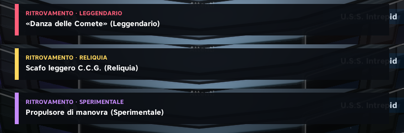

**Officina dell'Ingegneria.** Una scheda del pannello dell'Ingegneria elenca i pezzi in stiva ordinati per grado e colorati, con affissi, difetti e set. Si può **smontare** un pezzo per ricavarne crediti, oppure **tentare di potenziarlo** di un grado: costa crediti, la riuscita scende salendo di grado e, dal grado Sperimentale in su, un fallimento distrugge il pezzo. Leggendari non si diventa in officina: si trovano.

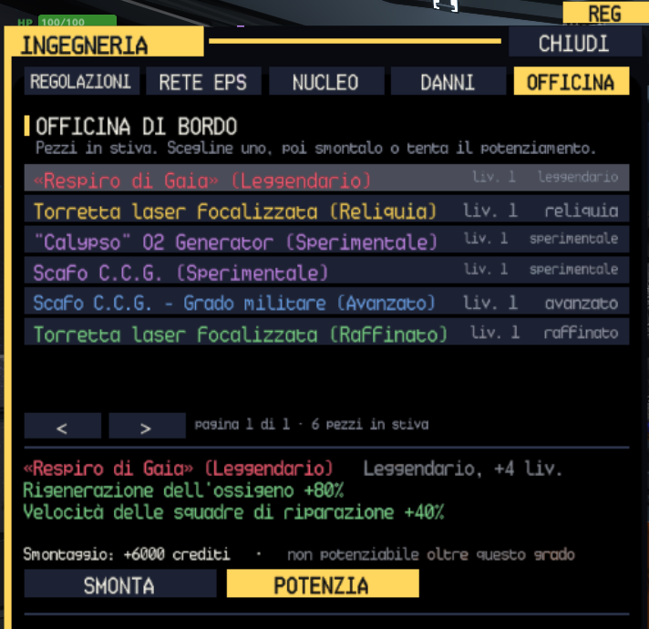

**Da dove arriva.** Oltre ai negozi e ai rottami, il bottino arriva in proporzione al rischio: ogni missione riuscita lascia un pezzo del livello giusto, gli archi narrativi conclusi bene almeno un Prototipo, le squadre rivali da Avanzato a Reliquia, il capo rivale Reliquia o Anomalo, e una crisi superata a volte lascia qualcosa fra i rottami.

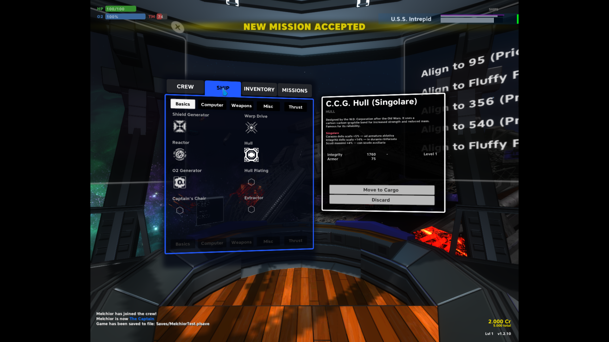

**Obiettivi.** 47 obiettivi interni: i 41 originali con le loro icone e il testo in italiano, più quelli legati alle aggiunte del mod. Si consultano con **F9**.


**Stato di servizio.** Statistiche personali (tempo per ruolo, salti, combattimenti, procedure di stazione, missioni…), 14 gradi da *Recluta* ad *Ammiraglio di flotta*, 5 specializzazioni con i loro titoli e la classifica di rete. Si consulta con **F10**.

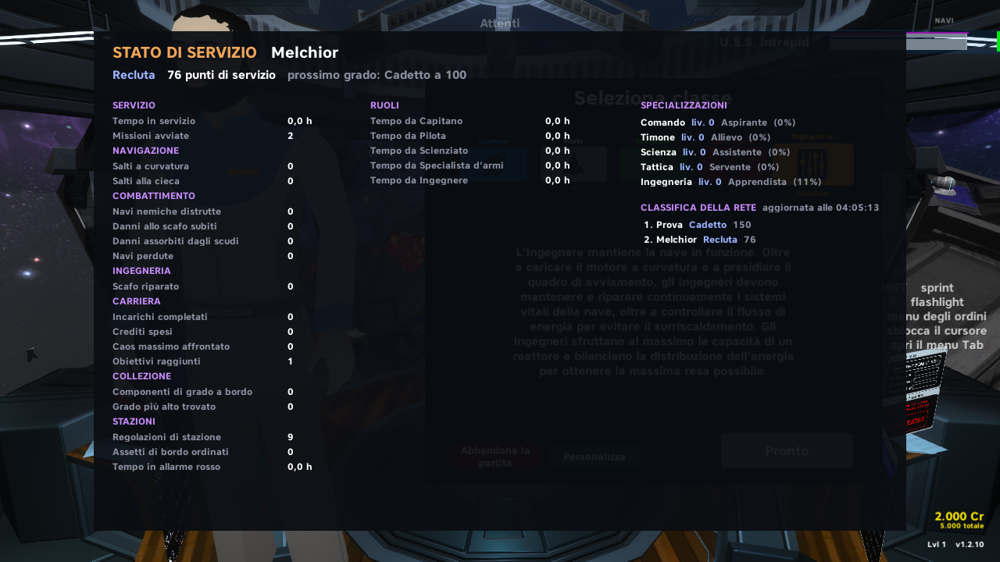

---

## Italiano e niente Steam

Il gioco è **interamente in italiano**: 10.690 stringhe tradotte con glossario coerente (gradi, sistemi, termini di plancia) e controlli automatici su segnaposto e formattazione. Tutti i riferimenti a Steam sono stati tolti dall'interfaccia e il multigiocatore passa dal Subspace Relay invece che dal cloud di Photon.


---

## Subspace Relay: il server di casa

Un server Node.js, senza dipendenze esterne, che parla il protocollo di **Photon PUN** (GpBinary 1.6 su TCP, scambio di chiavi Diffie-Hellman e cifratura AES): master server con lobby ed elenco partite, game server con stanze, proprietà, cache degli eventi e passaggio dell'host. In più:

- **classifica** e **statistiche globali** inviate dai giocatori, con copia di sicurezza giornaliera;
- **fazioni rivali** e **cronache delle galassie** persistenti;
- **telemetria di plancia** letta dagli eventi delle stazioni, **giornale di bordo** e **storico delle partite**;
- **annunci** a schermo, messaggi privati, avvisi, espulsioni ed **esclusioni** (anche a tempo e per indirizzo);
- **modalità manutenzione**, regolazioni dal vivo, riavvio pulito che salva tutto su disco.

Gira come servizio utente systemd su **Balthasar**, la macchina della rete di casa.

---

## Console di amministrazione

All'indirizzo `http://balthasar.local:4580/` c'è la console di gestione del server, nello stesso stile LCARS delle postazioni di bordo. È **riservata**: utente e password (salvata solo come hash scrypt), sessione in cookie protetto, blocco progressivo dopo i tentativi falliti, registro di ogni azione dell'amministratore. Nella scheda di ogni galassia compaiono anche la borsa delle merci (stiva, guadagni, ultimi carichi dei mercanti NPC), la logistica (viveri, medicinali, paghe arretrate), la ricerca, i porti con prosperità, sicurezza ed eventi, i capitani NPC conosciuti con livello, stile e talenti, le conoscenze del traffico e la scorta in corso. Il relay accetta cronache fino a 1,5 MB.


| Sezione | Contenuto |
|---|---|
| **Plancia** | Uptime, partite, giocatori, eventi al secondo, traffico, CPU, memoria, avvisi, grafici dell'ultima ora |
| **Partite** | Ingressi aperti o chiusi, visibilità, capienza, messaggi, chiusura; per ogni giocatore traffico, inattività, messaggio privato, avviso, espulsione, esclusione; plancia della nave in diretta e giornale di bordo |
| **Equipaggi** | Registro di tutti i giocatori visti dal server (nomi, indirizzi, versione, accessi, avvisi, note) con ricerca ed esclusioni |
| **Galassie** | Cronache (onore, infamia, archi, conseguenze in attesa) e fazioni rivali |
| **Classifiche** | Classifica per qualsiasi voce, statistiche globali con i primati, partite concluse, profili di servizio |
| **Sistema** | Grafici di un'ora o di 24 ore (rete, eventi, giocatori, CPU, memoria, ritardo del ciclo di eventi), dati della macchina e del relay |
| **Manutenzione** | Regolazioni dal vivo, modalità manutenzione, copie di sicurezza ed esportazione, riavvio, cambio password, sessioni aperte |
| **Registro** | Registro del server filtrabile e azioni dell'amministratore |

<table>
<tr>
<td></td>
<td>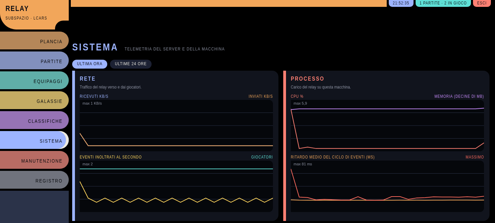</td>
</tr>
<tr><td align="center">Partite: giocatori e plancia in diretta</td><td align="center">Sistema: telemetria</td></tr>
<tr>
<td>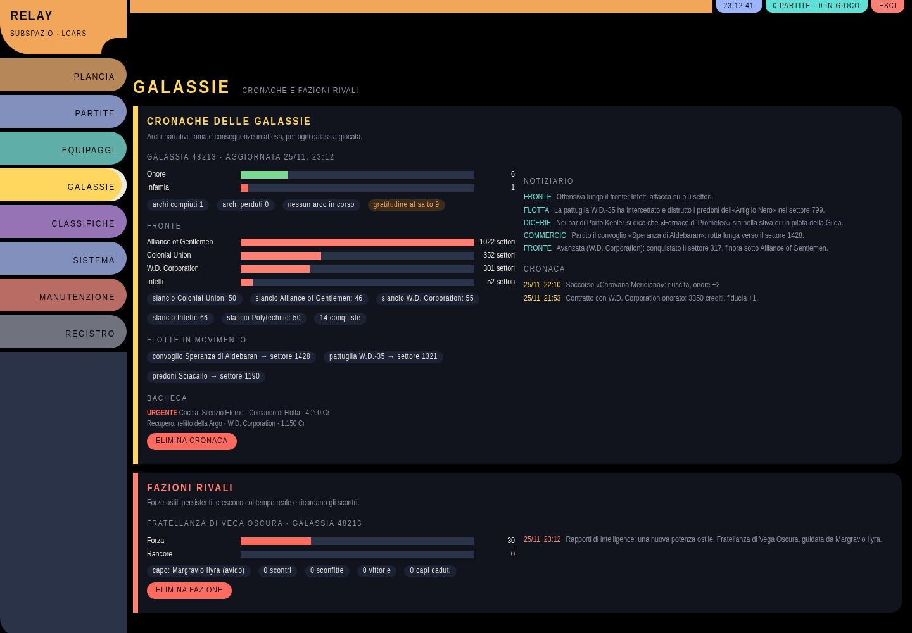</td>
<td></td>
</tr>
<tr><td align="center">Galassie: cronache e rivali</td><td align="center">Accesso riservato</td></tr>
</table>

---

## Architettura

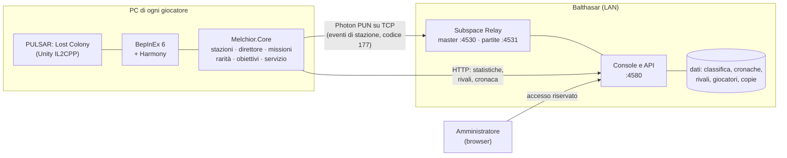

- Il plugin **non registra tipi propri** nel dominio IL2CPP: sotto Wine l'iniezione di classi corrompe la memoria. Si aggancia invece a metodi del gioco con Harmony (`PhotonHandler.Update` per il ciclo, `PLNetworkManager.OnGUI` per l'interfaccia a schermo) e a deviazioni native (detour) dove Harmony non può agire, come i costruttori.
- Le pagine delle stazioni sono costruite con l'API degli schermi del gioco (`PLUIScreen`), quindi vivono **sui monitor 3D della nave**.
- Lo stato delle stazioni è per nave e viaggia con un evento Photon proprio; l'host simula le chiavi dinamiche (nucleo, scansioni, manovre, danni, direttore) e le ripete periodicamente, così chi entra dopo si allinea da solo.
- Le missioni si registrano nelle due liste della campagna (`MissionTypes` e `PickupMissionTypes`) su ogni macchina; gli obiettivi personalizzati si completano sull'host.

---

## Installazione

### Giocare su Windows

1. Sul PC di sviluppo: `mod/pacchetto.sh dist "NomeGiocatore" --zip` crea `dist/PULSAR-Melchior-NomeGiocatore.zip` (circa 3,3 GB).
2. Sul PC Windows: estrai lo zip, per esempio in `C:\Giochi` (non in «Programmi»), e avvia `PULSAR_LostColony.exe`. Il mod si carica da solo tramite `winhttp.dll`.
3. Le istruzioni complete sono nel `LEGGIMI.txt` del pacchetto; il nome del giocatore si cambia in `settings.xml` (`<PlayerName>`).

### Giocare su Linux (Wine)

- Dal pacchetto: `./gioca.sh` (prepara un prefisso Wine proprio la prima volta); `MELCHIOR_WINDOW=1280x720 ./gioca.sh` per giocare in finestra.
- Dal repository di sviluppo: `mod/play.sh`.
- In `BepInEx/config/BepInEx.cfg` deve restare `UnityLogListening = false`.

### Il server su Balthasar

```bash
rsync -a server/ balthasar.local:subspace-relay-src/
ssh balthasar.local 'bash ~/subspace-relay-src/deploy/installa.sh'
ssh balthasar.local 'cd ~/subspace-relay && echo "password" | node server.js config.json --set-password admin'
```

`installa.sh` copia il relay in `~/subspace-relay`, crea la configurazione e lo avvia come servizio utente (`systemctl --user status subspace-relay`), attivo anche senza sessione aperta. Porte: **4530** e **4531** TCP per il gioco, **4580** per la console.

### Puntare il gioco al server

In `BepInEx/config/melchior.core.cfg`, sezione `[Relay]`: `Host = balthasar.local` e `Fallback = 192.168.178.27` (usato se il nome non si risolve). Con `Host = 127.0.0.1`, `mod/play.sh` avvia un relay locale.

---

## Configurazione

Tutti i file si trovano in `BepInEx/config/` e vengono creati con i valori predefiniti al primo avvio.

| File | Contenuto |
|---|---|
| `melchior.core.cfg` | Relay (host, riserva, porta), strumenti di sviluppo e diagnostica |
| `melchior.stations.json` | Comandi delle stazioni e loro effetti, assetti, bilanci, nucleo, scienza, armi, pilota, capitano, danni, sensori, ingaggio, protocolli, ufficiali automatici |
| `melchior.director.json` | Tempi di calma, allerta e respiro, soglie di tensione, pesi degli eventi, navi per fascia di potenza |
| `melchior.rarity.json` | Gradi di rarità (colori, pesi, livelli, affissi, difetti), catalogo degli affissi, leggendari e set: tutto modificabile |
| `melchior.ranking.json` | Statistiche, gradi e specializzazioni dello stato di servizio |
| `melchior.ui.json` | Lingua e pulizia dell'interfaccia |
| `server/config.json` | Porte, indirizzi, credenziali (hash), messaggio di benvenuto, limiti, manutenzione, conservazione dei dati |

---

## Sviluppo e collaudo

```bash
mod/Melchior.Core/build.sh          # compila il plugin (csc dell'SDK .NET, senza NuGet) e lo copia nel gioco
mod/tools/sig.sh Assembly-CSharp 'PLShipStats' 'Hull'   # firme interop di tipi e membri del gioco
node server/test/smoke.js           # collaudo end-to-end del relay: protocollo, partite, amministrazione, accesso
```

**Prove in gioco senza mouse né tastiera.** Con `DevConsole = true` il plugin esegue i comandi scritti in `BepInEx/config/melchior.cmd`; gli script in `mod/tools/prova/` li usano per avviare una partita in finestra, entrare a bordo, aprire i pannelli, scattare schermate e provare missioni e archi:

```bash
mod/tools/prova/newgame.sh 0                    # nuova partita come capitano
mod/tools/prova/cmd.sh "panels" "shot prova"    # elenca i pannelli e scatta una schermata
mod/tools/prova/famiglie.sh scorta              # avvia una missione, salta nel settore e la porta a termine
```

Alcuni comandi della console: `war` (`step`, `flip`), `fleets` (`step`, `near`), `news` (`diceria`, `bacheca`), `map`, `saga offline <ore>`, `loot` (bottino: `list`, `give`, `forge`, `bonus`), `ships`, `spawn`, `target`, `hit`, `panels click`, `con get|set`, `dir` (direttore), `mis` (missioni, anche `mis warp`), `saga` (cronaca), `rival`, `journal`, `svc`, `ach`. Con `MELCHIOR_INSTANCE=2` si avvia una seconda istanza sullo stesso computer per le prove a due giocatori.

---

## Modelli 3D importati

La mod contiene un importatore di modelli **GLB** (glTF 2.0 binario, il formato di Thrixel e di quasi tutti i generatori e di Blender), scritto senza librerie esterne: geometria, normali, coordinate di texture, indici a 8/16/32 bit, materiali con colore, texture incorporate (PNG o JPG), metallicità, ruvidezza ed emissione, gerarchia dei nodi con traslazione, rotazione e scala. Gli assi vengono convertiti da glTF (destrorso) a Unity (sinistrorso). I file vanno in `BepInEx/plugins/Melchior/models/`; `models.json` nella stessa cartella aggancia un modello a uno schermo di postazione (`"attach": "schermo:PLEngineerReactorScreen"`), con posizione, rotazione, scala ed eventualmente nascondendo il modello originale. In console: `model` (elenco), `model show <file> [distanza]` (lo mostra davanti al personaggio), `model clear`. Per le prove `mod/tools/model/test_glb.py` crea un modello di controllo con una texture scritta, per verificare che niente risulti specchiato.

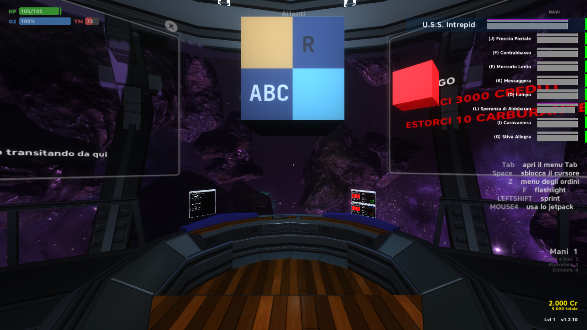

## Reverse engineering

Il gioco è compilato con IL2CPP: il codice C# originale non c'è. Il lavoro è partito da qui:

- `re/tools/il2cpp_meta.py` e `il2cpp_addrs.py` leggono i metadati IL2CPP e risolvono l'indirizzo di ogni metodo;
- gli script Ghidra in `re/tools/ghidra_scripts/` etichettano le funzioni e decompilano quelle che interessano;
- `lay.py`, `usage.py`, `xref.py` e `vt.py` ricavano il layout dei campi, i riferimenti a stringhe e tipi, i chiamanti e le tabelle virtuali;
- la campagna originale (186 missioni, 971 attori di dialogo) è un XML dentro gli asset, da cui sono stati ricavati i formati di obiettivi, ricompense e requisiti.

Il progetto Ghidra e le uscite (`re/out`) non sono nel repository: si rigenerano con questi strumenti a partire dal gioco.

---

## Struttura del repository

| Percorso | Contenuto |
|---|---|
| `mod/Melchior.Core/` | Il plugin (78 file, circa 20.000 righe): `Stations.cs` (stazioni e pannelli LCARS), `Director.cs`, `Missions.cs`, `Saga.cs` (stato salvato), `Rivals.cs`, `Bots.cs` e `CrewMind.cs` (mente dell'equipaggio), `Rarity.cs` e `Loot.cs` (bottino), `Traffic.cs` e `Derelicts.cs`, `Mysteries.cs` (indagini), `Passengers.cs` e `PassengersWalk.cs`, `Wear.cs` (usura), `Fabrication.cs` (officina), `Voices.cs`, `HudSkin.cs`, `Janitor.cs` e `HeapScan.cs` (memoria), `Achievements.cs`, `Service.cs`, `Ui.cs`, `DevConsole.cs`, `Plugin.cs` |
| `mod/i18n/` | Traduzione italiana: blocchi di testo, glossario, correzioni, script di controllo e generazione |
| `mod/achievements/` | Definizioni e icone degli obiettivi |
| `mod/tools/` | Lettore delle firme interop, script di prova in gioco, generatore delle icone degli obiettivi, cottura del font del terminale, modello GLB di controllo |
| `mod/pacchetto.sh`, `mod/play.sh` | Pacchetto per altri PC e avvio sotto Wine |
| `server/` | Subspace Relay: `server.js`, `lib/` (protocollo, partite, accesso, telemetria, rivali), `admin.html`, `test/`, `deploy/` |
| `re/tools/` | Strumenti di reverse engineering |
| `docs/` | Schermate |

---

## Stato e limiti noti

Verificato in gioco, con salti veri e due istanze in rete: tutte le stazioni e le loro procedure, gli ufficiali automatici, il direttore, le fazioni rivali, tutte e 9 le famiglie di missione, un arco narrativo completo e le conseguenze ritardate, la sincronizzazione fra due client attraverso Balthasar, la console di amministrazione. Con il relay locale: la coordinazione dei bot (pilota al timone, compiti divisi, incursioni respinte) e i talenti scelti da loro, i relitti, segnali, scavi e reliquie, l'HUD rivestito, i passeggeri (imbarco, eventi, consegna, figure a bordo), le folle senza conflitti di rete, il comando dell'equipaggio, usura, manutenzione e revisione, le voci, l'officina di bordo.

Ancora da verificare o da fare:

- una partita giocata a mano, con persone vere alle stazioni, e su due computer diversi;
- l'avvio su Windows del pacchetto (provato finora sotto Wine);
- salvataggio e caricamento con una missione in corso; chi entra a partita già iniziata;
- alcuni testi ancora in inglese (per esempio *Press [F8] to skip warp* e alcuni nomi di componenti);
- i prezzi dei negozi in funzione della reputazione: il mod scrive il valore nativo e il gioco lo sincronizza, ma lo sconto non è ancora stato osservato aprendo un negozio;
- le crisi, le taglie, gli incontri e l'esplorazione in una sessione lunga con salti veri dati dal pilota (provati con salti e scelte comandati da console);
- la scheda dell'incontro vista da un secondo giocatore (la scelta arriva all'host via rete, ma non è stata provata con due client);
- la galassia viva in una partita lunga con più giocatori (provata finora con prove guidate da console);
- HTTPS per la console di amministrazione (oggi è HTTP sulla rete di casa);
- la memoria cresce ancora di circa 17 MB a ogni salto (gusci di interfaccia delle navi distrutte): dimezzata rispetto all'inizio, ma non risolta; in partite molto lunghe conviene riavviare ogni tanto;
- dell'ultimo strato, provati solo con prove guidate da console: la spedizione rivale durante uno scavo, il pianeta d'origine di una civiltà, i guasti spontanei da usura, le voci a coppie viste a schermo, la pausa dell'officina in battaglia e il lancio della sonda fabbricata premuto dal pannello Scienza.

---

## Licenza

Il codice del mod (`mod/`), del Subspace Relay (`server/`) e degli strumenti (`re/tools/`, `mod/tools/`), la traduzione italiana, le icone dei nuovi obiettivi (`MEL_*`) e la documentazione sono distribuiti con la **GNU General Public License v3.0**: si possono usare, studiare, modificare e ridistribuire, purché le versioni derivate restino sotto la stessa licenza e con il codice sorgente. Il testo completo è in [`LICENSE`](LICENSE).

La licenza **non** si applica al materiale di PULSAR: Lost Colony, che resta di Leafy Games: i testi originali del gioco in `mod/i18n/chunks/in_*.jsonl`, le icone originali degli obiettivi in `mod/achievements/icons/` (quelle senza il prefisso `MEL_`) e le schermate del gioco in `docs/`. Il font JetBrains Mono in `mod/fonts/` è sotto SIL Open Font License 1.1 (vedi `mod/fonts/JetBrainsMono-LICENSE.txt`).

## Crediti e avvertenze

**PULSAR: Lost Colony** è di **Leafy Games**. Questo è un progetto amatoriale, non affiliato né approvato dagli autori del gioco, pensato per l'uso personale su una copia legittima del gioco. Il repository non contiene il gioco; testi originali (nella traduzione), icone degli obiettivi e schermate appartengono ai rispettivi proprietari.

Strumenti usati: [BepInEx](https://github.com/BepInEx/BepInEx), [Harmony](https://github.com/pardeike/Harmony), [Il2CppInterop](https://github.com/BepInEx/Il2CppInterop), [Ghidra](https://ghidra-sre.org/), Node.js. Il mod e il server sono stati sviluppati con l'assistenza di Claude.
